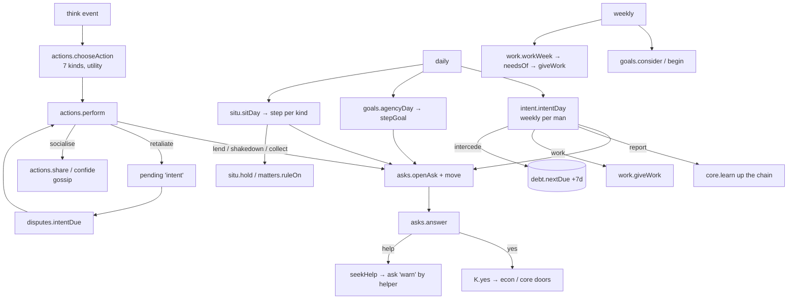
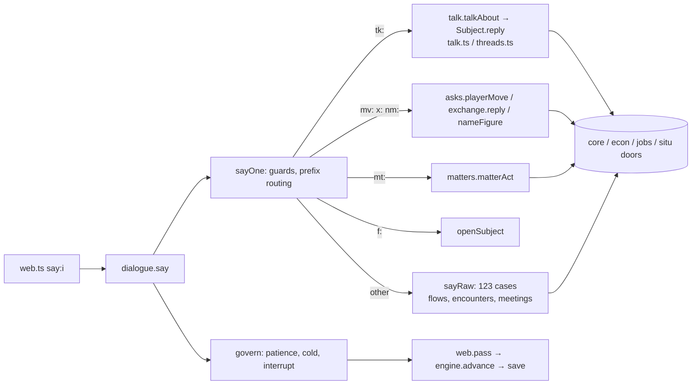
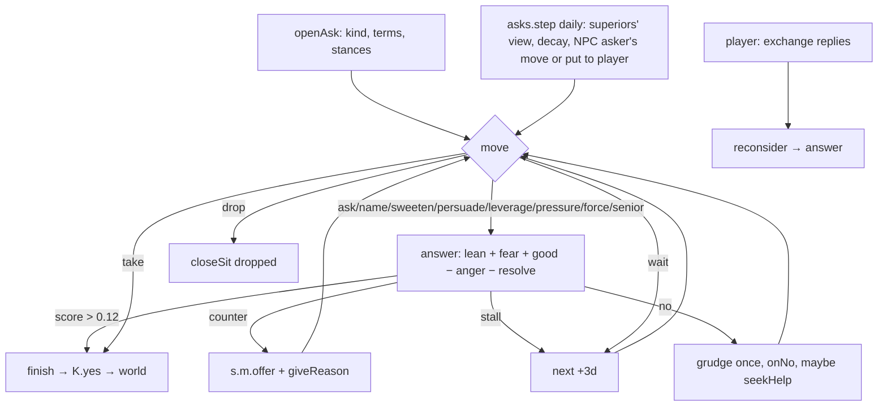
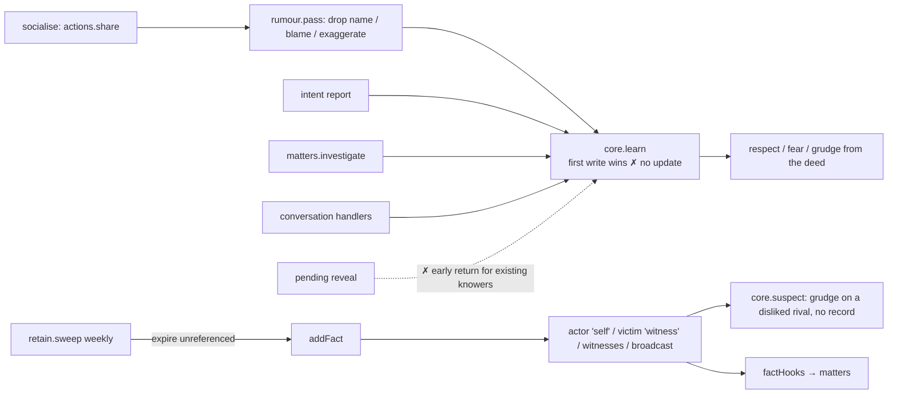
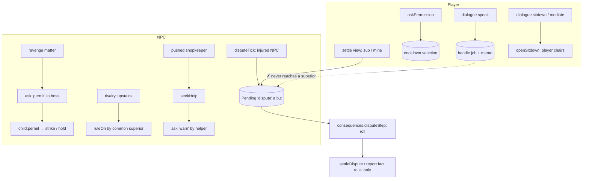
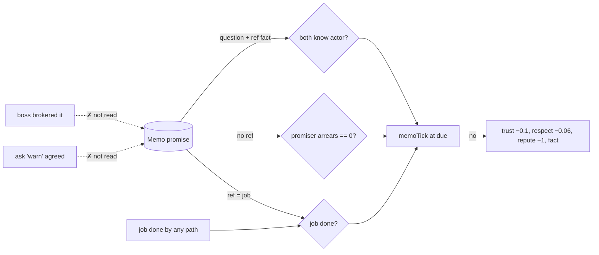
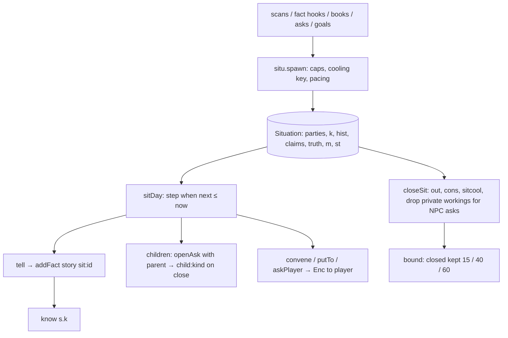
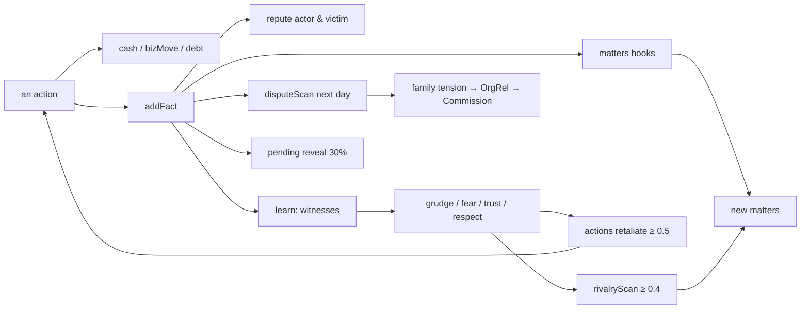

# OMERTÀ: complete systems architecture and interaction audit

*October 2026. A read-only audit of the repository at commit `bd5f0ee` (after the player-experience overhaul A–G). It was written to support the design of a new conversation and social-interaction architecture from first principles. It describes what the code does today. It proposes nothing.*

---

## 0. How to read this document

**Source of truth.** Every claim below was checked against the executable code in `src/`. References read `file.ts` › `function` (or `file.ts:line` where a line matters). Where this document disagrees with an older document (`FOUNDATION.md`, `V90_CONVERSATION.md`, `PLAYER_EXPERIENCE.md`, the module header comments), the code wins and the disagreement is noted.

**Verification beyond reading.** Behaviour that matters to a conclusion was run, read-only, through the real modules (scripts in [Appendix A](#appendix-a-reproduction-scripts); nothing was changed in the repository to run them):

| Probe | What it established |
|---|---|
| Ferrara reconstruction | The full path from a protection refusal to a broken promise (§12) |
| Promise inversion | A promise made through "Anyone been bothering you?" is judged by the player's own envelope arrears (§11) |
| "Ask who it was" | The name is spoken but the player's knowledge record does not change (§6) |
| Delayed reveal | A victim who already knew of an attack never learns who did it when the secret "comes out" (§6) |
| Save growth | Size of the save by component at day 0, 60 and 120 (§3.10) |

**Status vocabulary.** Used throughout, especially in the tables.

| Status | Meaning |
|---|---|
| **IMPLEMENTED** | The simulation does it, through a general mechanism, and something downstream reads the result |
| **PARTIAL** | It exists for some cases, some actors or some kinds only, or a downstream link is missing |
| **PLAYER-ONLY / NPC-ONLY** | Only one side can do it |
| **REACHABLE-NOT** | The code permits it but no screen or conversation leads the player to it |
| **DOCUMENTED-NOT-IMPLEMENTED** | A comment, label or document says it happens; the code does not do it |
| **MISSING** | Absent entirely |
| **UNCERTAIN** | Could not be settled without longer play or measurement |

---

## 1. Executive summary

### 1.1 The architecture in one page

OMERTÀ is a deterministic, event-queue simulation of about 165–180 characters in 1970 New York, in plain serialisable data (`types.ts` › `World`).

- **Time** moves only through `engine.ts` › `advance`. It processes a sorted queue of three event kinds:
  - per-NPC `think`;
  - `daily`;
  - `weekly`.
- **The player** never "thinks". Every player action is a UI handler (`web.ts`) that mutates the world directly or through a module function, then calls `pass(minutes)`, which advances the clock.

The simulation has a small number of genuinely shared, authoritative layers:

| Layer | Authoritative doors | What it is |
|---|---|---|
| **Events** | `core.addFact` | Every significant thing that happens is a `Fact`, with an actor, a victim, a business and a cause. |
| **Knowledge** | `core.learn`, `rumour.pass` | Per character, `known[factId]`: who told him, whether he knows who did it, how he knows, whom he wrongly blames. |
| **Relationships** | `core.feel` / `feelOn` / `regard` / `bear` / `ease` / `knowMore` | Directional `Rel`: trust, respect, affection, fear, grudge (with its reason), familiarity. The architecture tests enforce the doors. |
| **Money** | `econ.bizMove`, `core.createDebt` / `payDebt` / `restructure` / `writeDown`, `orgs.treasuryMove`, `ledger.post` | Businesses, debts, the family treasury and the player's circle each have one door, and audits replay them. |
| **Rank** | `rank.applyRank` | One door for every rank change; hierarchy repaired after. |
| **Situations** | `situ.spawn` / `tell` / `claim` / `closeSit` | One record for anything ongoing between people: parties, who knows what, history, claims, the hidden truth. |
| **Negotiation ("asks")** | `asks.openAsk` / `move` / `answer` / `finish` | 18 kinds of "one man wants something from another", one stance per side, the same moves for player and NPCs, and `yes()` that changes the real world. |
| **Work** | `work.needsOf` / `giveWork` / `judge`, `jobs.resolve` | Superiors hand out what their affairs need; men may refuse, botch, skim or lie. |

On top of these sit many **producers of intent**, each its own module with its own trigger rules:

| Producer | What it does |
|---|---|
| `actions.ts` | NPC moment-to-moment utility choice |
| `intent.ts` | Weekly social intentions; 7 kinds |
| `goals.ts` | Multi-week economic plans; 6 kinds |
| `matters.ts` | Rivalry, arrest, revenge, climb |
| `situ.ts` | Skim, intel, tribute, debt, partner, grudge |
| `disputes.ts` | Cross-family quarrels |
| `pulse.ts` | Ambient world events |
| `crewlife.ts` | The crew's wants and asks |
| `encounters.ts` | People come to the player |
| `consequences.ts` | Delayed outcomes |
| `politics.ts` / `powers2.ts` | Informants, coups, the Commission, rank powers |

The **conversation** is a separate, very large layer:

| Module | Lines | Role |
|---|---|---|
| `dialogue.ts` | 2,844 | Hub, subjects, a 123-case `sayRaw` switch |
| `talk.ts` | 622 | Subjects |
| `threads.ts` | 375 | Matters between you, as conversations |
| `exchange.ts` | 303 | The point in hand inside a negotiation |
| `react.ts` | 120 | How he answers |
| `flows.ts` | 370 | Older scripted flows |
| `voice.ts` / `voicesheet.ts` | 1,399 | Words |
| `memory.ts` | 65 | Remembered history |

It is not a single interaction model. It is a **menu generator plus a large dispatch of hand-written handlers**. Each handler calls into whichever simulation door is relevant, sometimes the shared negotiation engine and sometimes a bespoke effect. Conversations themselves are transient UI state (`ui/state.ts` › `View.talk.convo`). What persists is a scatter of side records:

- `Character.talk` (subject memory);
- `Character.memos` (promises, threats, agreements);
- `Character.denied`;
- `Situation.claims` and `Situation.m.claim`;
- jobs, asks and facts.

### 1.2 The most important gaps

Each is ranked and evidenced in §18.

1. **There is no general "request / commitment" model.** A promise is a `Memo` whose fulfilment test is one of three hard-coded rules:
   - a referenced job is `done`;
   - the promiser has no envelope arrears;
   - both men know who did something.

   Which rule applies depends on whether a `ref` was set, not on what was promised. The result is commitments whose fulfilment the game measures by something unrelated (§11.3, verified).
2. **Escalation is player-centric and has no "on behalf of".** The one mechanism by which a superior takes up a complaint (`Pending` kind `dispute`, `consequences.disputeStep`) records only the complainant, the offender and the go-between. When the player uses it for someone else, any compensation goes to the player, and the man he spoke for never hears of it (§12, verified).
3. **Knowledge cannot be corrected.** `core.learn` returns early if the fact is already known, so a man who knows *that* something happened can never come to know *who* did it through the normal door. This breaks:
   - "Ask who it was" in conversation;
   - the delayed "secrets leak" reveal, for exactly the victims it targets;
   - any later correction of a wrong belief.

   Both cases were verified (§6.6).
4. **Authority is not modelled as a capability.** Who may arrange a sit-down, rule on a quarrel, authorise violence or speak for the family is decided ad hoc inside each handler. An associate can chair a binding sit-down between a civilian and a soldier of his own family (`meetings.openSitdown` has no rank check). Conversely, there is no route by which the player can bring a third party's matter to his own capo (§8).
5. **At least nine parallel sit-down / mediation implementations** and **five parallel "bad blood" representations** exist. They do not share state (§8.6, §5.6).
6. **NPC multi-step plans exist only for economic goals** (`goals.ts`) and inside a few situation kinds (revenge asks leave; skim inquiries). No NPC can pursue "make this man stop threatening my business" through advice, a captain, negotiation and a sit-down (§9.4).
7. **Dialogue implies actions the simulation does not perform.** Examples:
   - "I'll speak to the Corrente family" creates a job to confront one man;
   - "It's mine to settle. Stand down" records nothing the player must then do;
   - "Deny it" changes no one's belief.

   §11.5 lists them.

### 1.3 Ferrara's Grocery, in brief

Reproduced exactly through the real code (§12). The incident is the `force` move of a `protect` ask (`asks.ts` › `ASKS.protect.force`). The shop's owner is a civilian, so no `Dispute` record is ever opened: `disputeScan` needs both men to be in families.

The owner's conversation offers "What can be done about it?" (`can_do` line: *"You could have a word with Lou, or put the two of us across a table"*), then two actions:

| Action | What it actually does |
|---|---|
| **"I'll speak to the Corrente family"** (`dialogue.ts` › `case 'speak'`) | Creates a `handle` job targeting the soldier himself, plus a promise memo due in 10 days. Nothing in the organisation receives it. |
| **"Let's put it to a sit-down"** (`case 'sitdown'`) | Opens an immediate meeting the player chairs himself, or fails if either man isn't awake and free at that minute. |

The only organisational route is "Take action against him" → "Go to [his superior]" on the soldier's own page (`revenge.ts` › `settleDo('sup')`). That route treats the matter as **the player's own** grievance:

- the superior may make the soldier pay the player;
- the owner never learns of it;
- the handle job stays open, so the promise is recorded as **broken** on day 10 even when the boss actually resolved it.

The disconnect is not one missing button. There is no object in the world that says "the player has undertaken, on the owner's behalf, to get the family to act against the soldier", so nothing can carry it, check it or report it.

### 1.4 The most consequential open questions

These are expanded in §19:

- What is the unit of interaction?
- How does an utterance become a durable claim, request or commitment with a machine-checkable fulfilment condition?
- How is authority represented so that "who may ask whom for what" is general?
- How do NPCs hold multi-party, multi-day objectives that run through other people?
- How does belief change (correction, contradiction, persuasion) without breaking the one-door knowledge model or the save budget?

---

## 2. Codebase map

About 28,000 lines of TypeScript in `src/*.ts`, plus `src/ui/*.ts` and `src/tests/**`. The table groups modules by the layer they belong to.

| Layer | Modules (lines) | Role |
|---|---|---|
| Core data and doors | `types.ts` (742), `core.ts` (627), `rng.ts` (27) | The data model; facts, knowledge, relationships, debts, death; seeded RNG |
| Clock | `engine.ts` (311) | Event queue, daily/weekly order, serialize/deserialize and migrations |
| World generation | `world.ts` (348), `names.ts`, `background.ts`, `kin.ts` | Creating the city, the families, the player; derived kinship |
| Economy | `econ.ts` (527), `books.ts` (603), `ledger.ts` (118), `rackets.ts` (336), `negotiate.ts` (26), `ways.ts` | Businesses and their transaction record; kick-ups and shortfalls; the player's ledger; enterprises |
| Organisation | `orgs.ts` (551), `rank.ts` (190), `career.ts` (548), `path.ts` (600), `powers2.ts` (639), `politics.ts` (312) | Families, succession, treasury, rank, promotion, the road, rank powers, Commission, informants |
| Work | `work.ts` (210), `orders.ts` (489), `jobs.ts` (1,267), `gigs.ts` (343) | Superiors' needs, orders, the job record and resolution, opportunities |
| NPC agency | `actions.ts` (435), `intent.ts` (157), `goals.ts` (1,137), `people.ts` (208), `crewlife.ts` (280), `pulse.ts` (416), `temper.ts` (135) | Utility actions, social intentions, multi-week plans, problems, crew wants, ambient events, temperament |
| Ongoing matters | `situ.ts` (983), `matters.ts` (801), `situations.ts` (139), `sitmoves.ts` (215), `disputes.ts` (336), `consequences.ts` (212), `revenge.ts` (196), `danger.ts` (224), `violence.ts` (171) | Situations and their kinds; cross-family disputes; delayed consequences; the player's settle-a-score menu; threat ladder |
| Negotiation | `asks.ts` (1,312), `askkinds.ts` (4), `exchange.ts` (303), `react.ts` (120) | The shared ask engine; the point in hand; composed answers |
| Information | `rumour.ts` (129), `retain.ts` (127), `reports.ts` (137), `news.ts` (56), `memory.ts` (65), `notebook.ts` | Versions of facts, salience, retention, what reaches the player |
| Conversation | `dialogue.ts` (2,844), `talk.ts` (622), `threads.ts` (375), `flows.ts` (370), `voice.ts` (390), `voicesheet.ts` (1,009), `club.ts`, `clubdata.ts`, `places.ts`, `where.ts` | Options, hub, handlers, subjects, words, where people are |
| Encounters and meetings | `encounters.ts` (1,008), `meetings.ts` (944) | People coming to the player; agenda-driven meetings incl. sit-downs |
| Persistence | `storage.ts` (227), `savestore.ts` (104), `consistency.ts` (68) | Async save store and snapshots; daily repairs |
| UI | `web.ts` (964), `ui/*.ts` (~5,200) | Rendering and the action dispatch (`handle`) |
| Tools | `cli.ts`, `bot.ts`, `stress.ts`, `src/tests/tools/*` | Headless play, long-run harness |

---

## 3. World simulation architecture

### 3.1 World state

`World` (`types.ts:516`) is one JSON-serialisable object. Every top-level collection:

| Field | Shape | Notes |
|---|---|---|
| `chars` | `Record<Id, Character>` | Everyone, player included (`isPlayer`). Never deleted; the dead stay with `alive: false`. |
| `biz` | `Record<Id, Business>` | Never deleted; closed ones have `open: false`. |
| `fam` | `Record<Id, Family>` | Organisations; membership is *not* stored here (read from `Character.familyId/bossId/rank`). |
| `facts` | `Record<Id, Fact>` | Event history (pruned by `retain.sweep`). |
| `debts` | `Debt[]` | All debts, any status. |
| `jobs` | `Job[]` | Work, tips, contracts, orders, summonses. |
| `situations` | `Situation[]` | V75 situations, V89 matters and asks (bounded by `situ.bound`). |
| `disputes` | `Dispute[]` | Cross-family quarrels (`disputes.ts`). |
| `grievances` | `Grievance[]` | Complaints heard at crew meetings and sit-downs (`meetings.ts`). |
| `pending` | `Pending[]` | Delayed consequences and intentions (`consequences.ts`). |
| `enc` | `Enc[]` | Requests put to the player, each a small scene with options. |
| `favours` | `Favour[]` | Who owes whom a good turn. |
| `threats` | `Record<Id, Threat>` | The danger ladder against the player (`danger.ts`). |
| `ops` | `Op[]` | Enterprises (everyone's). |
| `ventures` | `Venture[]` | Player partnerships in a shop. |
| `events` | `LifeEvent[]` | Weddings, funerals, christenings, dinners. |
| `agency` | `Agency` | NPC goals (`goals.ts`). |
| `txns`, `ledger` | arrays | Business transactions; player-circle money ledger. |
| `queue`, `seq`, `now`, `rng`, `nextId`, `seed`, `schema` | | The clock and identity counters. |
| Others | `promo`, `path`, `life`, `coup`, `papers`, `snaps`, `sunday`, `clubs`, `scene`, `sitcool`, `sitpace`, `intentStats`, `expect`, `goals`, `commissionAt`, `bj` | Player-centred or bookkeeping. |

### 3.2 Time

- **Units.** Time is in minutes (`HOUR=60`, `DAY=1440`, `WEEK=10080`). Day 0 is Monday 2 March 1970 (`core.fmtTime`).
- **The only clock.** `engine.advance(w, until)` pops events while `queue[0].t <= until`, sets `w.now = ev.t`, dispatches, then sets `w.now = max(now, until)`.
- **Ordering.** The queue is kept sorted by `(t, seq)` (`core.schedule`, binary insertion). Two events at the same minute run in the order they were scheduled.
- **No offline progression.** Time moves only when something calls `advance`.

| Caller | When |
|---|---|
| `web.ts` › `pass(minutes)` | After every player action, conversation line included |
| `web.ts` | Jail fast-forward (`advance(w, p.jailedUntil)`) |
| Meetings | `advance(w, w.now + res.minutes)` when a conversation opens one |
| Test and tool harnesses | As they need |

**Timing consequence: the world runs inside a conversation.** Every line said in a conversation costs minutes and calls `pass`, which calls `advance`. NPC `think` events, the daily tick (at midnight crossings) and even the weekly tick can fire between two lines of the same conversation. Nothing locks the man you are speaking to: he may be arrested, act or die between lines.

### 3.3 The three event kinds

**`think` (one per NPC)** (`engine.think`):

1. The player never thinks.
2. Skip if dead.
3. If jailed, reschedule to release + 10–120 minutes.
4. If asleep (`core.isAwake` against `wake`/`sleep` hours), reschedule to next wake + 0–90 minutes.
5. Otherwise `actions.perform(w, actions.chooseAction(w, c))` and reschedule at `now + minutes + 15..90`.

**`daily`**, in this exact order (`engine.ts:52-73`):

| # | Step | # | Step |
|---|---|---|---|
| 1 | `jobs.daily` | 12 | `path.pathTick` |
| 2 | `situ.sitDay` | 13 | `politics.politicsCoup` |
| 3 | `goals.agencyDay` | 14 | `politics.commissionTick` |
| 4 | `intent.intentDay` | 15 | `life.lifeDaily` |
| 5 | `meetings.summonsTick` | 16 | `life.christeningDue` |
| 6 | `dialogue.memoTick` | 17 | `ambition.ambitionTick` |
| 7 | `consequences.pendingTick` | 18 | `consistency.reconcile` |
| 8 | `encounters.encounterTick` | 19 | `disputes.disputeScan` |
| 9 | `encounters.eventTick` | 20 | `disputes.disputeTick` |
| 10 | `danger.dangerTick` | 21 | schedule next daily |
| 11 | `rackets.opsDaily` | | |
|   | `career.promoTick` (between 11 and 12) | | |

**`weekly`** (`engine.weekly`, then `retain.sweep`, `rank.repairAll`, `jobs.ventureWeek`, `politics.politicsWeek`, schedule next):

1. `news.paperTick`
2. `crewlife.lapsedAsks`
3. `crewlife.crewTick`
4. Player snapshot
5. Family hunts expire
6. **Random robberies** (inline)
7. `econ.businessWeek`
8. Former protectors told
9. **Debts fall due** (inline: `core.accrueVig`, `core.payDebt` or `missed++`; default at 4 missed → `econ.seizeShare`)
10. `rackets.enterpriseWeek`
11. `work.workWeek`
12. `path.turfWeek`
13. `orgs.orgWeek`
14. `powers2.rankWeek`
15. `reports.reportTick`
16. `situations.situationTick`
17. `situ.sitWeek`
18. `matters.mattersWeek`
19. Tension decay (inline)
20. `sitmoves.friendsTell`
21. `pulse.pulseWeek`
22. Seats opened at random (inline)
23. Wages and living costs (inline)
24. `people.peopleWeek`
25. `books.settleWeek`
26. `career.careerTick`
27. `goals.agencyWeek`
28. `consequences.purge`
29. Per character: `core.feelingsWeek` and an arrest roll (inline)

**Timing dependencies that matter for any new system:**

- **The weekly money cycle is order-sensitive:**
  - businesses trade before debts fall due;
  - debts are paid from pocket, then from the till;
  - enterprises earn before kick-ups;
  - kick-ups (`settleWeek`) run bottom-up through the chain so a man's take includes what his men just passed him.
- **Within a day:** situations step, then NPC plans, then social intentions, then summonses, then **promise checks (`memoTick`) before delayed consequences (`pendingTick`)**. A promise falling due the same day as the consequence that would have kept it is judged first. This is part of the Ferrara breakage, §12.
- **`consistency.reconcile` runs late in the day.** It closes memos whose referenced fact is resolved, drops grievances and expires duplicate jobs ("two men on the same piece of work: the first keeps it"). It can expire a job a promise refers to (§11.4).

### 3.4 Event processing and causality

- **The record.** `core.addFact` is the door for history. A `Fact` has a kind (42 `FactKind`s), actor, victim, business, amount, text and `textHidden` (for a hidden hand). It may also carry `cause` (another fact), `story` (`'sit:<id>'`, a dispute id, `'seat:rank'`), `minor` and `heard` (gossip count).
- **Side effects of `addFact`, in order:**
  1. Familiarity between actor and victim (`knowMore`).
  2. Reputation (`DEED` table → `repute`).
  3. A chance of a delayed `reveal` for a hidden hand (`Pending`).
  4. `learn` for actor, victim (unless `victimKnows: false`) and witnesses, with `suspect` for victims who don't know the actor.
  5. `learn` for `broadcast` recipients.
  6. Registered **fact hooks** (`factHooks()`): `matters.ts` opens matters from events (arrest, beating, killing). Hooks are guarded against re-entry: a matter's own facts don't start new matters.
- **Causality** is recorded only where a caller passes `cause`:
  - retaliation records the fact the grudge is about (`actions.perform` › `retaliate` uses `rel.why.f`);
  - `ASKS.protect.force` links the vandalism to the refusal;
  - debts link to their loan fact;
  - grievances link to their fact.
  - Many effects record no cause.
  - There is no general causal graph.
  - `dialogue.connected` and `thenLine` infer links by shared actor, victim or business and say so ("I couldn't tell you whether the two are connected").
- **Situations** are the second history mechanism: `Situation.hist` (bounded to 8), `cons` (what it left behind) and `out` (how it ended).

### 3.5 Autonomous NPC decisions (overview; detail in §9)

Five independent decision loops:

| Loop | Cadence | Chooses | Mechanism |
|---|---|---|---|
| `actions.chooseAction` | Every `think` (hours) | One of work, socialise, lend, collect, shakedown, gamble, retaliate | Additive utility from traits, cash, relationships, cooldowns, plus `rng.next()*0.12` |
| `intent.intentsOf` | Weekly per man (`hash(id)+day) % 7 == 0`) | One of 7 social intentions, if score ≥ 0.40 ± 0.05 | Utility; acts through asks, `learn`, `work`, `bear` |
| `goals.consider` / `stepGoal` | Weekly creation; steps when due | Multi-stage economic plan (6 kinds) | State machine per kind; uses asks |
| Situation / matter steps | Daily when `s.next <= now` | The next move in a skim, rivalry, revenge, etc. | Per-kind step functions, often utility-scored (`rivalChoice`) |
| Ask steps | Daily when due | The asker's next negotiation move | `asks.npcMove` utility; the answer from `asks.answer` |

### 3.6 Deterministic randomness

- **The RNG.** `rng.ts` is a seeded generator whose `state` is serialised with the world (`engine.serialize` writes `rng: w.rng.state`). The same seed plus the same player actions give the same history. `src/tests/determinism.test.ts` proves it across separate processes and through save/load.
- **Hash-based variety.** Several systems avoid consuming the RNG by hashing ids and days:
  - `asks.jitter` (FNV of `s.id:k:day`);
  - `core.flavour` (variant by fact id);
  - `dialogue.ack` pool choice;
  - `exchange.pick`;
  - `kin` ties read from surnames;
  - `temper` (temperament derived, never stored).
- **Option listing does not consume the RNG** (checked: no `w.rng` in `optionsRaw`/`hub`/`gather`). It does create relationship records (`rel()` in `gather.hide`, `optionsRaw`). Executing an option (`sayRaw`, `talk.ts` replies) does consume it.
- **No `Math.random` and no wall clock** in simulation code (a project rule in `CLAUDE.md`).

### 3.7 Save, load and persistence

- **Format.** `engine.serialize` = `JSON.stringify({...w, schema: SCHEMA, rng: w.rng.state})`. `SCHEMA = 7` (`types.ts:32`).
- **Loading.** `engine.deserialize` rebuilds the RNG, calls `world.ensureShape` (which fills absent fields, including organisations via `orgs.ensureOrgs`), then applies ordered migrations:
  - v<4: stakes onto businesses; protection arrears as amounts;
  - v<3: introductions;
  - v<2: seat quotas;
  - plus unconditional repairs: kick rates, hustles → enterprises, `w.scene = null`, added shops, default skills, standing, books, memos.
- **Storage.**
  - `savestore.ts` uses IndexedDB, falling back to localStorage.
  - `storage.ts` keeps one main save (`omerta-save-v3`) plus bounded day snapshots (localStorage: 3 within a 4.2 MB budget; IndexedDB: 7).
  - A save is reported good only after it is read back.
- **When it saves.** `web.ts` › `save()` runs at the end of every `pass`, so **after every conversation line**.
- **Not persisted.** UI state (`ui/state.ts` › `S`) is not saved. That includes the current view, **the conversation in progress (`Convo`)**, the back stack and the log. A reload mid-conversation loses the conversation; only what it wrote into the world survives (`Character.talk`, memos, asks, facts). The older club "scene" (`w.scene`) was the one persisted conversation, and Stage 5C made `deserialize` close it.
- **Compatibility rule** (CLAUDE.md, `docs/02-state-saves-and-compatibility.md`): new fields optional with defaults; never break old saves; add a fixture to `src/tests/fixtures/` when the schema changes. `saves/oldsave.test.ts` loads genuine old saves, including a schema-2 save.

### 3.8 Event history and retention

- **Facts** are pruned weekly by `retain.sweep` (`retain.ts`). A fact survives while anything can still use it. Every copy of a dropped fact in `known` goes with it.

  | Tier | Kept |
  |---|---|
  | **permanent** | Always: promotions, deaths, rulings, failures, informants, sit-downs, events, defaults (`retain.ts:15`) |
  | **active** | While anything references it (`referencedFacts`): a debt, dispute, pending event, memo, encounter, scene, or a later fact's `cause` |
  | **expired** | Otherwise dropped |

- **Other bounds:**

  | Record | Bound |
  |---|---|
  | `Situation.hist` | 8 |
  | `claims` | 3 |
  | `cons` | 5 |
  | Closed asks | 15 |
  | Closed own-kind matters | 40 |
  | Other closed situations | 60 |
  | Open situations | Per-kind caps (`SIT.cap`) |
  | `Character.memos` | Trimmed to 24 undone |
  | `Character.talk` subject memory | 18 keys (`dialogue.sayOne`) |
  | `Dispute.history` | 14 |
  | `career.log` | 12 |
  | `Agency.ended` | A ring |
  | NPC-only favours | 120 open; settled ones forgotten after 60 days |
  | `Character.rels` | **Not bounded** |
  | `Character.known` | Bounded only through fact expiry, plus bystander thinning of ageing significant facts |

### 3.9 State validation

| Mechanism | What it checks / does |
|---|---|
| `consistency.reconcile` (daily) | Repairs drift: closes stale grievances and memos, expires duplicate jobs |
| `econ.ledgerCheck` | Replays `w.txns` against every business's cash |
| `econ.economyIssues`, `orgs.orgIssues`, `orgs.treasuryCheck` | Treasury in − out = balance |
| `rank.hierarchyIssues` | Invariants: a living boss heads each family; everyone answers to a living, senior man of his own family; no loops |
| `goals.agencyIssues` | Agency invariants |
| `AGENCY.audit` | A money-conservation check around each goal step |
| `audit()` (used by tests) | Aggregates the above |
| `src/tests/architecture.test.ts` | Source scans that keep the doors closed (§17.11) |

### 3.10 Performance and data growth (measured)

Seed 3, the player idle (`scratchpad/size.ts`, Appendix A):

| Day | Save | Characters | Facts | Situations (open) | Largest parts |
|---|---|---|---|---|---|
| 0 | 0.27 MB | 165 | 8 | 0 | rels 136k, books 16k |
| 60 | 2.21 MB | 168 | 475 | 67 (40) | **rels 1,349k**, known 237k, books 126k, facts 100k, situations 56k |
| 120 | 3.43 MB | 178 | 878 | 144 (56) | **rels 1,941k**, known 601k, facts 190k, books 137k, situations 131k |

**What this means:**

- **Relationships are about 57% of the save.** They are unbounded in count and carry free text (`why.text`, `bond.text`).
- **Per-character knowledge** is the next fastest-growing part.
- **The localStorage budget is 4.2 MB.** Any new per-pair or per-utterance record must budget against this; IndexedDB raises the ceiling but is not guaranteed.
- **CPU cost:**
  - `ownerBiz` is cached (`core.ownerCache`) because it is called millions of times a run;
  - `actions.generate` scans every living character for `socialise` and `retaliate` on every NPC `think`;
  - `options()` rebuilds the full hub, calling `gather`, `optionsRaw` and `subjectsOf` several times per render.

### 3.11 Authoritative entry points, and who may change what

| State | Authoritative door(s) | Enforced? |
|---|---|---|
| Rank | `rank.applyRank` | Architecture test |
| Business cash | `econ.bizMove` | Architecture test |
| Trust / respect / affection / fear | `core.feel`, `feelOn`, `feelAtLeast`, `feelTo`, `regard` | Architecture test |
| Grudge, standing | `core.bear*`, `ease*`, `repute` | Architecture test |
| Debt terms and balance | `core.createDebt`, `payDebt`, `accrueVig`, `restructure`, `writeDown` | Architecture test |
| Work orders | `work.giveWork` (`orders.ownJob` for the player's own) | Architecture test |
| Knowledge | `core.learn`, `rumour.pass` | **Not enforced:** `talk.ts:530` writes `c.known[f.id] = {...}` directly; `threads.ts:343` and `encounters.ts:712` patch `knowsActor` |
| Character cash | Anyone | **No door:** dozens of modules write `c.cash ±=` directly (e.g. `matters.conceal`, `disputes.sitdownChoose`, `intent`, `meetings`) |
| Ownership | `econ.transferBusiness`, `sellTo`, `addStake`, `seizeShare`, `succeedOwner` | Convention |
| Protection | `econ.setCollector`, `payProtection` | Convention |
| Family tension | Direct writes in `actions.tension`, `disputes`, `consequences`, `politics`, `pulse` | No door |
| Situations | `situ.spawn` / `tell` / `claim` / `closeSit` | Convention; `s.m` is free-form scratch written by everyone |

**Can systems modify the same state independently? Yes, extensively.** Some examples:

- A debt's `nextDue`/`missed` is changed by:
  - `threads.ts` (a week's grace);
  - `intent.ts` (intercession: `d.nextDue += 7*DAY` directly);
  - `encounters.ts` (`debtor` speak);
  - `econ.giveTime`;
  - the weekly settlement.
- A man's grudge against another is raised by:
  - knowledge (`learn`);
  - suspicion (`suspect`);
  - asks (refusals, coercion);
  - matters;
  - meetings;
  - conversation handlers.

  The one-door rule guarantees *how* a value changes (clamped, with a reason), not *who* may change it or whether two systems double-count one event. Duplicate consequences are a live risk (§17.6).

---

## 4. Character architecture

`Character` (`types.ts:113`). For each category: where it lives, what writes it, what reads it, and parity.

| Category | Stored in | Written by | Read by | Player ≡ NPC? |
|---|---|---|---|---|
| **Identity** | `id`, `name`, `nick`, `look`, `bg` (player), `district`, `wake`/`sleep` | `world.ts`; `actions.perform` (district on travel) | Everything; `where.ts`/`places.ts` (location) | Same |
| **Traits** | `traits` {greed, violence, ambition, caution, sociability, vice, courage} | `world.ts`; nudged by meetings (`ambition +0.01`) | Every utility function | Same fields. The player's traits are not used for the player's choices; `temper(p)` derives from `p.conduct` |
| **Temperament** | Not stored. `temper.temper(c)` derives courage, caution, volatility, pride, agreeable, empathy from traits + id signature; the player's from `conduct` | `temper.noteConduct`/`noteHard` (player's `conduct`) | asks (stance, answers), matters (`rivalChoice`, `confront`), react, exchange, voice | NPC derived; player emergent |
| **Skills** | `skills` {muscle, driving, charm, nerve, brains} | `people.rollSkills`, `people.grow` | Job resolution, asks `persuade`/`pressure`, aptitude | Same |
| **Ambition / wants** | `want` (NPC private want), `ambition` (player's chosen goal), `Agency.goals` (NPC plans) | `pulse.motiveTick`, `situ` (punished unfairly → independent), `goals.begin`, `ambition.ts` (player) | `crewlife.wantFor`, dialogue `ask_want`, goals | **Separate:** player `ambition` vs NPC `want` + `goals` |
| **Money and assets** | `cash`, `wage`, `weekIncome`, `lifetimeKick`, `lifetimeGross`, `books`, `cars`, `goods`; businesses via `Business.ownerId`; stakes on `Business.stakes`; enterprises in `w.ops` | Everywhere (no door for `cash`); `core.earn`/`record` for income | Utilities, asks (`loanPosition`, `canPay`), intents, goals | Same records; player-only `prepaid`, `stance`, `side` in books |
| **Organisation** | `familyId`, `bossId`, `rank`, `kickRate`, `sponsor`, `backer`, `prospect` | `rank.applyRank`, `rank.repairHierarchy`, `orgs.leave/defect`, `career.promote`, `orders.recruitProspect`, dialogue `rk_back` (`backer`) | Everything | Same fields |
| **Authority** | Not stored. Implied by `rank` and the `bossId` chain (`situ.chainUp`, `commonSuper`, `dialogue.isSuperior`, `flows.stanceOf`) | | Each handler decides | See §8 |
| **Employment / assignments** | `job` (player's day job), `w.jobs[].assignee`, `w.ops[].runner` | `orders`, `work.giveWork`, `work.delegate` | `jobs.activityOf` (busy), `work.pickMan` | NPCs get orders; the player gets offers |
| **Relationships** | `rels[otherId]: Rel` {trust, respect, affection, grudge, fear?, known?, why?, bond?, lastMet} | The `core` doors only | Everything social | Same structure; player gains damped by `regard` |
| **Reputation** | `standing` 0–100; `rep` (player's word record); `conduct` (player) | `core.repute`; `crewlife` (`rep`); `temper.noteConduct` | `influence`, readiness, openSitdown, answers | `standing` shared; `rep` and `conduct` player-only |
| **Grudges** | `rels[x].grudge` + `why` | `core.bear`/`ease` | `actions` (retaliate ≥ 0.5), `matters.rivalryScan` (≥ 0.4), stance anger, openness (hostile ≥ 0.3) | Same |
| **Familiarity** | `rels[x].known` 0..1; `intro` (player: who he has been introduced to) | `core.knowMore`, `link`; `p.intro` set by introductions | `feelOn` (weights trust/liking gains), `dialogue.introduced` (gates conversation) | `known` shared; `intro` player-only gate |
| **Knowledge** | `known[factId]: Knowledge`; `struggling[bizId]`; `insight` (player's worked-out notes) | `core.learn`, `rumour.pass`, direct writes (§3.11) | Dialogue, intents (report), work (`needsOf`), revenge, rumour | Same; `insight` player-only |
| **Memory of conversation** | `talk[key]: {d, sig, n}` (bounded 18); `denied[factId]` | `dialogue.sayOne`, `talk.remember`/`said`, `threads.setClaim` | Hub (freshness), threads (held to a claim) | **NPC records about the player only** |
| **Social intentions** | Not stored as intentions: the act runs immediately (`intent.Intent.act`); its trace is a cooldown (`cooldown['int:*']`) and whatever ask it opened | | | NPC-only |
| **Current plans** | `w.agency.goals[]` (`Goal`: stage, next, with, sit, asked, deadline…); `w.pending` kind `intent` (a planned reply); open asks with `terms.by === c.id` | `goals.ts`, `actions.perform`, `disputes.planReply` | `goals.stepGoal`, `pendingTick`, `asks.step` | NPC-only |
| **Promises / obligations** | `memos[]` (on the man promised to); `w.debts`; `w.favours`; `w.jobs` (assigned); `Books.arrears` | §11 | §11 | Asymmetric (§11) |
| **Location / availability** | `district`; `wake`/`sleep`; `jailedUntil`; `hurtUntil`; derived `where.whereIs`, `places.present`, `meetings.available` | `actions.perform` (travel), `jobs.jail`, retaliation (hurt) | Witnesses, meetings, conversations | Same |
| **Death / prison / departure** | `alive`, `diedAt`, `jailedUntil`, `informant`, `rank: 'civilian'` after expulsion | `core.handleDeath`, `jobs.jail`, weekly arrest roll, `orgs.leave`/`defect` | Everything filters `alive` | Same |
| **Cooldowns** | `cooldown: Record<string, number>` (≈ 60 key patterns: `ret:*`, `lend:*`, `int:*`, `shut:*`, `rg:*`, `st:*`, `askmv:*`, `mt:*`…) | Everywhere | Everywhere | Same map, different keys |

**How characters choose what they want and whom they approach:**

- **Moment to moment (`actions.generate`):**
  - **targets:**
    - everyone known or nearby (socialise);
    - shop owners (lend, shakedown);
    - debtors (collect);
    - men with grudge ≥ 0.5 (retaliate).
  - **ranking:** additive scores; one best action per think.
- **Weekly intentions (`intent.intentsOf`):** each intention computes its own target from relationships:

  | Intention | Target chosen |
  |---|---|
  | `time` | The creditor |
  | `intercede` | The man the creditor trusts most whom he trusts ≥ 0.3 |
  | `help` | The best of trust + affection·0.5 + boss bonus − grudge among men with cash ≥ 1.5× the need |
  | `report` | His superior |
  | `amends` | The man with a grudge against him whom he likes |
  | `confront` | His own man who hurt the family |
  | `work` | His superior |

- **Plans (`goals.ts`):** targets come from the plan:
  - a business by score;
  - a "bridge" man trusted by both (`goals.bridge`);
  - a lender;
  - prospects.
- **The player as a target:** NPCs reach the player only through the same intentions and plans, when the player is the best target (`helper.isPlayer` → `encounters.makeLoan`; `by.isPlayer` → `askToIntercede`; `asks.askPlayer`), plus dedicated generators (`encounters.encounterTick`, `crewlife.crewTick`, `goals.joinAsk`, `situ.convene`, `matters.putTo`).

---

## 5. Relationships and social consequences

### 5.1 The model

`Rel` (`types.ts:34`) is **directional**: `a.rels[b]` is how `a` feels about `b`. It is created lazily by `core.rel()` (which writes) or read without creation by `core.peek()` (a frozen default `{trust .1, respect .3, affection .1, grudge 0}`).

| Dimension | Meaning in code | Gains | Losses | Weekly drift (`feelingsWeek`) |
|---|---|---|---|---|
| `trust` | Reliability | `feelOn`: × max(0.15, 1−v) × (0.4 + 0.6·known); bond kept | Undamped | −6%/wk towards 0.1 if not met in 14 days |
| `affection` | Liking | Same as trust | Undamped | Same |
| `respect` | Esteem | Damped by 1−v | Undamped | Converges towards the other's `standing`/100 (+ rank above), at a speed set by familiarity |
| `fear` | Wariness (V90) | Damped | Undamped | ×0.9/wk; deleted < 0.02 |
| `grudge` + `why` | Resentment, with the event behind it | `bear` (reason kept if it did most lately) | `ease` | Eased by 0.88–0.96/wk (pride holds longer) |
| `known` | Familiarity | `knowMore` (time together, shared events), `link` | | ×0.99/wk after 28 days apart |
| `bond` | What trust/liking rests on | `feelOn` with a reason; `bondFor` (favours) | | |
| `lastMet` | When they last spent time | `socialise`, conversations | | Drives the 14-day decay |

**Player-specific damping.** `core.regard(w, npc, player, field, amount, kind)` halves a gain each time the same kind of gesture repeats with the same man within a week (`player.cooldown['rg:<npc>:<kind>']`). Many conversation handlers do *not* use `regard`. They call `feelOn` directly through `sayRaw`'s `tweak()`, so the repetition rule is applied unevenly.

**Social talk has a ceiling.** `sayOne` caps trust at 0.6 and affection at 0.8 from `how`, `old_times`, `drink` and `op`, and damps a third exchange a day or a sixth a week to 20%.

### 5.2 Favours, loyalty, rivalries, history, reputation

| Concept | Representation | Notes |
|---|---|---|
| **Favour** | `w.favours: Favour {from, to, size, what, settled, asked}` via `encounters.addFavour` (also writes `bond`) | Called in through `asks.callFavour` (ask kind `favour`) by NPCs (`favoursWeek`) and the player (`favcall:` in the hub); used as leverage (`asks.leverageOf`) |
| **"Favour" memo** | `Memo` kind `favour` (`dialogue` `recommend`: "You owe him one") | **Not** a `Favour`: cannot be called in, is not leverage. Duplicate representation |
| **Loyalty** | Not a field. Approximated by trust/respect towards the boss (`work.refuses`, `matters.talkChance`, `orgs.discontent`, `orgs.candidates`) | |
| **Rivalry** | Situation kind `rivalry` (`matters.ts`), started by `rivalryScan` (grudge ≥ 0.4 among men in the life) | Its own heat (`s.m.heat`); ends by peace, ruling, blows, cooling |
| **Personal history** | `Rel.why`/`bond` (one reason each); facts known to both; `powers2.ledgerOf` (who made whom); `memory.recall` (V77 lines from records) | No per-pair event log |
| **Reputation** | `standing` (0–100, via `repute`, `DEED` per fact kind on `addFact`); `influence` (derived: rank, support, access, holdings, wealth); per-viewer `respect`; player `rep`/`conduct`; `crewlife.reputationOf` (words) | |

### 5.3 How an interaction changes a relationship

**Exact mechanisms:**

1. **Through a fact** (`addFact` → `learn`):
   - respect for the actor and victim of a known deed (`DEED × 0.01`);
   - fear of a violent actor (× (1−courage));
   - grudge, fear and lost trust for a victim (`GRUDGE` table);
   - grudge for someone close to the victim (×0.3).

   This is the main persistent channel, and it is knowledge-gated (only those who know).
2. **Through an ask:**
   - `answer`: a first refusal → grudge +0.05 on the asker;
   - `finish`: coerced → grudge 0.12 + `afterwards` (tells a friend, nurses it); willing → trust +0.03;
   - `pressure`/`force` → fear;
   - `persuade`/`sweeten` → only the matter's `Stance`.
3. **Through a situation verdict:** `situ.hold` moves trust and respect with the chair, and grudges against whoever came out ahead.
4. **Through conversation handlers:** direct `tweak`/`feelOn`/`bearOn` on `t.rels[p]`, plus `regard`.
5. **Through time together:** `socialise` → `knowMore` + compatibility-scaled trust/affection, or a grudge if incompatible (`core.compat`).
6. **Through favours:** `addFavour` writes `bond`; `onDebtCleared` → trust +0.05, grudge −0.15.

**How changes influence later behaviour:**

| Value | Read by |
|---|---|
| Trust | `actions.share` (gossip gate ≥ 0.25), `openness` (what he will say), `holdsBack`, intents (helper/intercessor thresholds), `asks.freshStance` (goodwill), `work.pickMan`, sit-down chair scores, `loanPosition`, `sponsorOf` (≥ 0.35), promotion |
| Grudge | Retaliation (≥ 0.5), rivalry (≥ 0.4), stance anger, hostile openness (≥ 0.3), `rumour.pass` (blame a hated man), `refuses` |
| Fear | Stance fear, `rivalChoice`, `confront`, `governs` patience |

### 5.4 Decay

`core.feelingsWeek` (weekly, every character, every relationship): grudge ×hold, fear ×0.9, trust/affection decay when apart, familiarity decay, respect convergence. Situation `Stance` anger/fear −0.03 per ask step. The tension between families ×0.9 above 1 each week.

### 5.5 Temporary conversational reactions vs persistent consequences

| Transient (lost when the conversation ends or the matter closes) | Persistent |
|---|---|
| `Convo.ctx.patience`, `cold`, `shut`, `raised`, `asked`, `follow`, `used`, `spoken` | `Rel` fields |
| `Stance` {resolve, fear, anger, good, tried, last} per ask. Kept while open; **deleted on close for NPC-NPC asks** (`closeSit`) | `cooldown['shut:<id>']` (a day) |
| `exchange` point in hand (`s.m.beat/claim/claimT`), on the matter while open | `Character.talk` (subject memory, claims) |
| | Memos, favours, facts (and therefore knowledge) |

### 5.6 Duplicated or contradictory mechanisms

**Five representations of "bad blood"**, none reading the others:

1. `Rel.grudge` (person to person).
2. `Threat` (`w.threats[enemy]`, danger ladder vs the player).
3. `Dispute` (cross-family, per pair of men).
4. `Family.tension` (family to family).
5. `Family.rel[*].grievance` (OrgRel, derived weekly from tension, disputes and leaders' grudges).

A rivalry situation adds a sixth scalar, `heat`.

**Other duplications:**

- **Two suspicion mechanisms for a hidden culprit:**
  - `core.suspect` raises a grudge (+0.3) against whoever the victim already disliked in another family, **without recording the belief**;
  - `rumour.pass` records `Knowledge.blame`, and bears a grudge only when the listener was hurt.

  A man can therefore hold a grudge from `suspect` with no record of whom he suspects or why beyond `why.text`.
- **Two favour representations:** `Favour` vs memo `favour`.
- **Two regard paths for the player:** `regard` (damped repetition) vs `tweak`/`feelOn` (undamped).
- **Fear:** `Rel.fear` vs `Stance.fear` (per matter, starts from `viewOf`). Intended (V90: "a negotiation's own stance, S.fear, is not a relationship"), but the two diverge freely.

---

## 6. Knowledge, information and memory

### 6.1 The four stages, and how far each is represented

| Stage | Representation | Explicit? |
|---|---|---|
| **1. What actually happened** | `Fact` (`w.facts`). Also hidden truths: `Situation.truth`, `Report.truth` / `lie`, `Grievance.valid`, `Job.claimTrue`, `WeekBook.tone`, `Books.skim/hide`, `Business.protection.why`, `Character.informant` | Yes |
| **2. What a character believes** | `Character.known[factId]: Knowledge` {t, from, knowsActor, how ('s'/'t'/'h'), blame, big}. Situation-level: `Situation.k[id] = {l: 1 suspects / 2 knows, via, t}`. A boss's certainty in a skim matter: `s.m.cert` (one number, the boss's). | **Partial** |
| **3. What that character says** | Generated at the moment of speaking from (2) and his temperament (`rumour.versionOf`, `dialogue.told`, `holdsBack`, `openness`, `exchange.giveReason`, `react.speak`). Stored only in specific places (below). | **Mostly not stored** |
| **4. What the listener comes to believe** | `core.learn(listener, fact, from=speaker, knowsActor)` and `rumour.pass` (which may drop the name, add a wrong blame, or exaggerate). | Partial |

**Where stage 2 is weak:**

- **A belief can only be about a recorded fact.** There is no free-standing proposition ("Lou is behind it", "the shop can't pay", "the boss favours me"). The workarounds:
  - `blame` (a wrong name attached to a real fact);
  - `struggling[biz]`;
  - `insight` tags;
  - a matter's `k` level.
- **Beliefs about the future, intentions or other men's beliefs** are not representable.

**What is stored of stage 3 (what was said):**

| Store | Contents |
|---|---|
| `Situation.claims` | `{by, text, honest, t}`, bounded 3 per situation (skim explanations, undermining, revenge guesses) |
| `s.m.why` / `s.m.claim` | The reason given in a negotiation (exchange.ts), on the matter |
| `Character.talk['claim:earn']` | A crew man's account of his money: slow / coming / admitted / denied (threads.ts) |
| `Character.denied[factId]` | Facts he lied about to the player |
| `Report {text, truth, lie}` | A job report |
| `Character.talk[subject]` | That a subject was discussed and its signature, not what was said |

**Where the stages collapse:**

- **Saying is learning.** A man telling the player something calls `learn` directly; there is no intermediate "claim" the listener can weigh.
- **The player's own statements are not represented at all.** When the player lies ("Deny it", `dialogue` `lie`) the NPC either believes or doesn't (one roll). If he believes, nothing about his belief is recorded: his knowledge record still says what it said.
- **What an NPC says to an NPC** is never text. It is a `learn`/`pass` call (`actions.share`, `intent` report, `matters.investigate`), with distortion only through `pass`.

### 6.2 Objective events and witnesses

**Who learns at the moment of a fact** (`addFact`):

- the actor (`self`);
- the victim (`witness`, knowing the actor unless `hiddenActor`);
- the listed `witnesses`;
- `broadcast` recipients (`public`).

**Witnesses** are drawn by `core.witnessesAt`: awake, free people in the district, 25% each, at most 3, sometimes filtered by a further chance.

**After that, knowledge spreads only through:**

| Channel | How |
|---|---|
| `actions.share` (socialise) | Trust ≥ 0.25 or a sociable teller; NPC↔NPC 2 facts by salience, capped by `retain.gossipCap` and freshness; to the player 1 fact |
| `actions.confide` | His own business struggling |
| `intent` `report` | Up the chain |
| `core.notifyProtector` | A protected shop calls its protector |
| `matters.investigate` | Asking around in a matter |
| Conversation handlers | `who`, `tell_more`, `witness`, threads `ev:*:source/who`, `talk.ts` |
| `meetings` | The boss tells the family meeting |
| `sitmoves.whisper` / `friendsTell` | Club and friends |
| `consequences` | `reveal` (see the defect below) |
| `news.paperTick` | The Monday paper (text only; not knowledge) |

### 6.3 Rumours, suspicion, false beliefs, deception

| Capability | Status | Where |
|---|---|---|
| Know something but refuse to disclose it | **IMPLEMENTED** | `holdsBack` (by archetype, trust, shame), `openness`, `rumour.pass` (a man does not give up his own people), threads `ev:source` (protects a source), `talk.ts` gating by trust |
| Believe something false | **PARTIAL** | `Knowledge.blame` (a wrong culprit) and `big` (exaggeration); `core.suspect` (a grudge without a recorded belief); the boss's `cert` in a skim matter; a revenge `guessed` target. No false belief about anything other than "who did it" or "how much" |
| Deliberately lie (NPC) | **IMPLEMENTED in specific systems only** | Job reports (`orders.behaviour` → `Report.lie`); skim explanations (`situ.skimStep`, `claim(... honest:false)`); crew earnings (`threads` `earn`: "slow" when skimming); undermining a rival to the boss; a revenge target who "wasn't me" (`denied`). Exchange reasons are **truthful tests of the world**, not lies |
| Contradict an earlier statement | **PARTIAL** | Only crew earnings: a man who claimed "slow" or "denied" is held to it (`threads.claimOf`/`setClaim`); a denied fact can be confronted (`confront:` row). Elsewhere what was said is not stored, so it cannot be contradicted |
| Be confronted with evidence | **PARTIAL** | `earn:missing` (only when `p.books.flags` or an expected/declared gap shows it); `confront:<fact>` (a denial, once the player knows the actor from someone else); `job:again` (`orders.questionReport`); skim matters (NPC boss); `press` |
| Change belief | **MOSTLY MISSING** | `core.learn` never updates an existing record (early return). Exceptions patch fields directly: threads `ev:who` sets `knowsActor`; `encounters.ts:712` hides it. No mechanism retracts a wrong `blame`, upgrades `how`, or marks a belief as disproved |
| Reveal the source of information | **IMPLEMENTED** | `rumour.sourceOf` (player view), threads `ev:source` (he names who told him, or protects him), `dialogue` `source` ("Where did you hear it?") |
| Promise secrecy | **PARTIAL** | Encounter `tell` ("Not a word": no record); `matters.conceal` (money for silence, `s.m['hush:<id>']`, read nowhere else); favour kind `silence` (an ask) |
| Break secrecy | **MISSING** | No record of a secrecy promise that a later telling checks |
| Spread a false accusation | **PARTIAL** | `rumour.pass` blame (spreads a wrong name); `revenge.ts` `undercut`/`shame` (player); rivalry `undermine` (NPC; `claim(... honest:false)`); `consequences` `truth` (a false accusation behind a killing comes out later) |

### 6.4 Reporting up the hierarchy

- **NPC.** `intent` `report`: hostile facts touching the family, under 10 days old, not stale, that his superior doesn't know. A weekly intention, cooldown 5 days. The boss then `learn`s it, which feeds `work.needsOf` (a man who hurt him or his men → a `handle` need) and situations.
- **Player.** The player reports nothing automatically. He can pass things on in conversation (`pick_concern`, "Pass something on", `report` codes in group org; `talk.ts` `tellOn`).
- **Crew to the player.** `reports.reportTick`, `w.expect` (report weekly/asked; trouble tell/handle) and the Sunday envelopes (`crewlife.openSunday`).

### 6.5 Forgetting and visibility

- **Forgetting.** Knowledge is forgotten only when the fact is pruned (`retain.sweep`), or thinned for bystanders of ageing significant facts. `stale()` marks a fact out of date when the world has moved on: the debt paid, the shop came round, the man is out, the operation is running again, the business recovered. Stale knowledge is said as such, and `intent` `report` ignores it.
- **The player's knowledge restriction** is the same `known` map. Every screen is supposed to read `p.known` (`sitmoves.visibleTo`, `stories.knowsMatter`, `talkview`), and `Situation.truth` is never shown.

### 6.6 Verified knowledge defects

1. **"Ask who it was" does not teach the name** (`dialogue.ts` › `case 'who'`). The option appears only when the player knows the fact without the actor. The handler calls `learn(..., true)`, which returns at `if (c.known[fact.id]) return`.
   - **Verified:** he says *"It was Mickey Greco."* and `p.known[f].knowsActor` stays `false`.
   - **Consequence:** options gated on `pk.knowsActor` stay hidden, so the player cannot act on what he was just told: `speak`, `sitdown`, `confront`, settle options.
2. **The delayed reveal skips the people it targets** (`consequences.pendingTick` › `reveal`). It iterates the victim, the protector and those close to the victim, and calls `learn(id, f, 'public', true)` for anyone who doesn't know the actor. But the victim learned the fact at the moment of the event (without the actor), so `learn` returns early.
   - **Verified:** the victim's `knowsActor` stays `false` and no grudge forms.
   - **Consequence:** "secrets leak; sooner or later whoever was hurt usually finds out" (`core.addFact` comment) does not happen for victims. Reputation for the deed is still applied.
3. **Direct writes bypass `learn`'s side effects** (respect, fear and grudge from a deed): `talk.ts:530` (`c.known[f.id] = {...}`).

---

## 7. Economic systems

### 7.1 Character finances

| Aspect | How it works |
|---|---|
| **Cash** | `Character.cash`, changed directly by many modules. Income is recorded by `core.earn`/`record` into `books.gross[source]` and `weekIncome`. |
| **Weekly costs** | Wage minus living cost (`engine.LIVING` by rank), then lifestyle spending above a floor (6–10% of cash above it). |
| **Books** | `Books` (`types.ts:94`): this week's gross by source, expenses, arrears owed upward, missed weeks, honest weeks, skim/hide decisions, history (8 `WeekBook`s), flags on subordinates, and for the player stance/prepaid/side. |

### 7.2 Businesses

- **Record.** `Business` (`types.ts:168`): owner, manager, stakes, protection, cash (readonly; only `econ.bizMove`), distress, damage, investment, accounts (`acct`), owner history.
- **Weekly trade.** `econ.businessWeek`: revenue × `perf()` (manager quality, neighbourhood, competition, investment, trouble), expenses, then:
  - the protection fee (`payProtection`: pays what it can, records `owed` and the true `why`);
  - stakes paid to holders;
  - the owner's draw.
- **The record.** Every movement is a `Txn` in `w.txns`, struck into weekly `acct` and audited by `ledgerCheck`.

### 7.3 Ownership, stakes, managers

| Operation | What changes |
|---|---|
| `econ.transferBusiness(b, to, how)` | `ownerId`; `owners` history; `ownersChanged`; an `ownership` fact |
| `econ.sellTo(buyer, b, price, share?)` | Money buyer → owner, then `transferBusiness` or `addStake` |
| `econ.addStake` | Pushes `Stake {holder, share, since, how}` (the total is capped by `stakeRoom` = 0.6) |
| `econ.seizeShare` | On debt default (engine weekly), the creditor takes a stake |
| `econ.succeedOwner` | On death |
| `econ.setManager` | Sets `managerId` (or hires) |

### 7.4 Criminal enterprises

`w.ops: Op` (`types.ts:593`), one record for everyone since Stage 4.

- **Starting one.** `rackets.canStart` and `startOp`.
- **Weekly.** `enterpriseWeek`: take, cost, heat, raids, runner skim (`op.skimmed`), level, bad weeks.
- **Delegation.** `work.delegate`: a senior NPC puts one of his men in as runner (`op.cut 0.15`), and suspects a light take → `situ.opSkimNoticed` (a skim matter).
- **The player.** Counts (`rackets.countOp`) and rules (`opRule`).

### 7.5 Loans, repayment, interest, arrears, renegotiation

**Record.** `Debt` (`types.ts:263`): principal, `owed` (principal left), `arrears` (unpaid vig), `balance` = owed + arrears, weekly rate, weekly payment, next due, missed, status, reason, cause (the loan fact).

| Event | Operation |
|---|---|
| **Creation** | **Only** `core.createDebt` (posts a `ledger` entry). Callers: `ASKS.borrow.yes`, `ASKS.lend.yes`, `actions` (a gambling marker), `encounters` loan, `crewlife`, `talk.ts` invest, `situ` debt step, dialogue `offer_loan` paths through asks |
| **Weekly** | Engine: `accrueVig` (vig on `owed` only), then `payDebt` if the debtor (pocket + till − 100) can, else `missed++` and a `debt_missed` fact; 4 missed → `defaulted` + `seizeShare` |
| **Payment** | `core.payDebt`: pocket then till, creditor `earn`, ledger, arrears first, `missed = 0` if a full payment, cleared → `onDebtCleared` (jobs expired, memos closed, grudge eased, trust up, encounters lapsed) |
| **Renegotiation** | `core.restructure(d, {rate, payment})`, `core.writeDown(d, amount)` (forgiveness), and `nextDue`/`missed` edits for "more time" |

**Where "more time" is written (no single door):**

- `threads.ts` `debt:<id>:week` (`d.nextDue += 7*DAY; d.missed−1`);
- `intent` `intercede` (the same, directly, with a `terms` fact);
- `encounters` `debtor` `speak`;
- `ASKS.time.yes` (`restructure` to half the payment);
- `situ` debt matters.

**What persists after "another week" is agreed:** only the changed `nextDue` and `missed`. No memo records that time was given (threads adds no memo for the debt case; it does for crew earnings). The creditor's leniency is not remembered as a favour or agreement unless the path adds one.

### 7.6 Protection

| Aspect | How it works |
|---|---|
| **The arrangement** | `Business.protection {collectorId, familyId, fee, late, owed, why, hold, since, total}` |
| **Weekly** | `payProtection` |
| **Starting** | `ASKS.protect` (asked, countered, forced) → `econ.setCollector` + `protection_started` fact; a poach → a `poach` fact + `informPrev` |
| **Late shops** | `work.needsOf` makes a `shake` need for late shops |
| **Damaged shops** | Protected shops that are damaged get a `guard` need |
| **When the owner is pushed** | `ASKS.help` (the owner asks his protector, the player) |
| **Other routes** | Dialogue: `suggest`, `terms_cut`, `terms_raise`, `sh_*`; `talk.ts` subjects (`pressed`, `shop` `poach`) |

### 7.7 Family dues, treasury, kick-ups

**Kick-ups** (`books.settleWeek` → `settleOne`, bottom-up):

1. Each member declares, possibly concealing (`skim`, `hide`).
2. He passes `kickRate × declared` up, with arrears.
3. The superior compares what he got with what he can see (`expected`, `visibleSources`), records `flags[sub]`, and an NPC superior `react`s:
   - n=1: warn;
   - n=2: make up + arrears;
   - n≥3: `discipline` (beating, taking a shop, or doubled debt and a raised share);
   - or `situ.skimNoticed` opens a skim matter.

**Other money flows:**

- **Levies** (a family-wide 7% for 4 weeks) and greedy captains raising shares.
- **Rate negotiation:** `books.askRate` / `rateTalks`; `ASKS.rate`.
- **The treasury:** `Family.treasury` through `orgs.treasuryMove`, audited (`tin/tout`). `treasuryWeek`: dues from made men, support for men inside; lawyers (`matters`).
- **The player's Sunday envelope:** `books.handOver` / `envelopeDue`, stance `honest`/`shave`/`stall`.

### 7.8 Acquisitions, investment, financial pressure, misconduct, disputes

| Topic | How it works |
|---|---|
| **Acquisition** | `ASKS.buy` / `sell` / `run` (Stage 4), with figure ranges, `sellerFloor`, `priceOf`; NPC `goals.businessStep` (scout → approach → negotiate → finance → close) through the same functions |
| **Investment** | `Business.invest`, `bizMove(...'invest')`; `talk.ts` invest (a loan on the books) |
| **Pressure** | `distress` → `business_struggling` facts (confided), `intent` `help` (borrow), `situations` (money kind) |
| **Misconduct** | Skim/hide in books; runner skim in ops; job reports that lie; all detected through comparison and situations |
| **Business disputes** | `Dispute` kind `territory` (poach) between families; `pulse.ts` border disputes (turf situations); `partner` situations (`situ.partnerStep`) |

### 7.9 Authoritative economic operations a conversation engine would invoke

| Intent | Operation | Records left |
|---|---|---|
| Lend / borrow | `core.createDebt` (via `ASKS.lend`/`borrow` `yes`) | Debt, `loan` fact with `cause`, ledger entry, memo `agreement` (player borrows only) |
| Pay / settle | `core.payDebt`; `core.writeDown` | Debt state; `debt_paid` fact (minor) |
| More time / easier terms | `nextDue`/`missed` edits; `core.restructure` | Debt fields only |
| Buy / sell / stake | `econ.sellTo` (→ `transferBusiness`/`addStake`) | Owner history, stake, `ownership` fact, txns |
| Protection | `econ.setCollector`; `payProtection`; `giveTime`/`clearArrears` | Protection record, facts |
| Management | `econ.setManager` | `managerId` |
| Enterprise | `rackets.startOp`, `closeOp`, `countOp`, `opRule` | `Op` |
| Money between people | **No door.** Direct `cash` edits; the player's circle posts to `ledger.post` | Sometimes a fact |

**Answers to the brief's examples:**

- **A loan is agreed.** `ASKS.lend.yes` (lender asking) or `ASKS.borrow.yes` (borrower asking):
  1. moves cash (or `bizMove(... 'aid')` into the business);
  2. `createDebt`;
  3. adds a `loan` fact as the debt's `cause`;
  4. closes the ask (`closeSit` 'agreed').
- **A business is sold.** `econ.sellTo` → money, then `transferBusiness` (owner, history, `ownersChanged`, fact) or `addStake`.
- **More time is given.** Only `Debt.nextDue`/`missed` change. Nothing records the agreement as an agreement.
- **A man promises to make up missing money.**
  - Crew earnings (`threads` `earn:week`): a `Memo` kind `promise` on the **player's** memos, `other` = the man, `due` = 7 days. `memoTick` keeps it if his `books.arrears === 0` on the day.
  - The player promising his boss (accounts meeting `promise`): a memo on the boss, same rule.

---

## 8. Organisations, hierarchy and work

### 8.1 Structure

- **Families.** `w.fam` holds history, standing, treasury, relations (`rel`), tension, unrest, consigliere, heir, acting boss, hunt, directive, levy and seat quotas.
- **Membership and hierarchy** are read from `Character.familyId/bossId/rank` (`orgs.ts` header). `rank.repairHierarchy` keeps the invariants.
- **Crews** are not records: a crew is "men whose `bossId` is X" (`work.menOf`, `crewlife.crewOf`, `econ.crewGround` for its ground).
- **Rank ladder** (`rank.LADDER`): civilian, associate, soldier, capo, underboss, boss.

### 8.2 Promotion, recruitment, sponsorship, careers

| Topic | NPCs | The player |
|---|---|---|
| **Readiness** | `career.readiness` ← `path.pathInfo` (passed up, work, backing, name, proof) | Same function; path.ts goals and a trial |
| **Promotion** | `careerTick` weekly: a vacancy (`capOf`, `openSeatFor`), eligible candidates, 50% chance, `promote` (sponsor = `sponsorOf`) | `promoTick`: a `PromoCase` with encounters at stages (sponsor, rival, boss), then an induction summons |
| **Sponsorship** | `sponsorOf` = backer or boss with trust ≥ 0.35 | Dialogue `rk_back` sets `p.backer` if trust ≥ 0.5 and respect ≥ 0.35 (an immediate roll); `recommend` (a respect bump on the boss, and a memo "favour" that is not a `Favour`) |
| **Asking for a seat** | | `powers2` / `path` (`Pending` kind `seat` → `seatDecision`) |
| **Recruitment** | `goals.recruitStep` + `ASKS.recruit`/`join` | `orders.prospects` / `recruitProspect` (immediate), `ASKS.recruit` (dialogue `recruit_offer`) |
| **Succession** | `orgs.succeed` (scored candidates; heir; unrest) | Player can become boss through `path` chair options |

**Promotion is a weekly evaluation, not a conversation outcome.** No one asks for a promotion and is answered through the negotiation engine. The player's request is staged encounters around a deterministic readiness check.

### 8.3 Work: assignment, delegation, completion, reports, discipline

| Step | Mechanism |
|---|---|
| **Needs** | `work.needsOf(superior)`: money owed him, late shops on his book, his men inside, a man (not of his family) who hurt him or his men, an unprotected shop in his crew's ground (capo+), a damaged shop of his |
| **Choosing the man** | `work.pickMan` (aptitude, trust, free) |
| **The door** | `work.giveWork`: the player gets an **offer** (`via 'boss'`); an NPC may **refuse** (grudge, respect, fear, pride, roughness) → grudge, a `report` fact, career note; otherwise `mkJob` (`via 'order'`) + `jobs.assign` |
| **Execution** | `orders.runCrewJob` (NPC men: `behaviour` = clean / skim / gamble / unavailable / distracted / confront / mercy / bungle, and a `Report` that may lie); `jobs.resolve` (the player, by approach) |
| **Judging** | `work.judge` (NPC superior: may catch a lie → `discipline` fact, grudge, repute −3, money back); the player questions his men in the report view / threads `job:` |
| **Record** | `work.noteWork` (career counts: led, rough, hard) |
| **Delegation of enterprises** | `work.delegate` |
| **Discipline** | `books.react` / `discipline` (shortfalls); `situ` skim verdicts (repay / punish / overlook / expel); `intent` `confront` (dressing a man down) |

### 8.4 Authority and escalation: the brief's questions

| Question | Answer from the code | Status |
|---|---|---|
| **Who can request intervention?** | **NPCs:** an injured man in a cross-family dispute (`disputeTick` → `Pending dispute` to his boss); a man pushed in a demand (`asks.seekHelp` → protector, close made kin or a friend in the life → a `warn` ask on his behalf, or the police); a debtor (`intent` `intercede`, to a man the creditor trusts); an avenger (`ASKS.permit` to his boss). **The player:** for his own grudges (`revenge.settleDo` `sup`/`mine`); when threatened (`danger` `boss`); a squeezed side operation (`encounters` `squeeze` `boss`); the rivalry `upstairs` option | PARTIAL; separate per path |
| **Who can authorise intervention?** | Violence against a made man: the asker's boss (`politics.askPermission` for the player, a roll; `ASKS.permit` for NPC avengers, the negotiation engine). Nothing else requires authorisation | PARTIAL |
| **Who can arrange a sit-down?** | Anyone who reaches the code path: the player as associate (`meetings.openSitdown`, no rank check; `disputes.callSitdown`, only for a cross-family dispute the player is in); a superior (`matters.ruleOn`, `situ.convene`); the Commission (abstract) | Ad hoc |
| **Who can speak for the family?** | Not modelled. The boss's acts are the family's in texts; `politics.commissionTick` acts on family tension, not people; `consequences.disputeStep` has the go-between "speak to the other side" as text | MISSING as a capability |
| **Who can issue orders?** | Any NPC soldier+ to his own men (`workWeek`); the player to his men (`orders.giveOrder` through `giveWork`); the player's boss to the player (offers) | IMPLEMENTED |
| **Who can delegate decisions?** | A senior man delegates an enterprise (`work.delegate`); the player can "pass" a sit-down he was asked to settle (`situ.sitChoose75` `pass` → his own superior settles); `w.expect` (the player's crew rules) | PARTIAL |
| **Who can overrule another?** | A chair's verdict binds the parties (situ `hold`, `ruleOn`); a cautious NPC boss calls off his man's messy ask (`asks.superiors`) or a planned reply (`disputes.intentDue`, 40%); the player's boss calls him in (`Enc 'word'`) | PARTIAL; per path |
| **How does a subordinate bring a matter to a superior?** | NPC: `intent` `report` (news only), `ASKS.permit` (leave to strike), rivalry `upstairs` (a ruling). The player: conversation with his boss (`b_need`, `promo`, `report` in group org, `pick_concern` "Pass something on"), `settleDo` `mine` | PARTIAL |
| **What happens when the superior agrees?** | Path-specific: `permit` yes → the avenger strikes; `Pending dispute` → `disputeStep` rolls brokered / shrugged / brushed off; `rk_back` → `backer` | — |
| **When he refuses?** | `permit` no → most avengers hold back (`closeSit 'held back'`), hot ones strike anyway; `askPermission` no → respect −0.03, no further path | — |
| **Can the superior delegate the matter?** | **No.** No path in which a superior hands a request down to one of his men as work, except `work.needsOf` creating work from what he *knows* (e.g. he learned of an attack on his man → a `handle` need). A request is not a need | MISSING |
| **Can the player fulfil the same roles?** | As **chair**: yes (sit75 encounters, rivalry `rule` for capo+, `openSitdown` at any rank). As **superior** receiving a subordinate's request: partially (crew meetings' grievances, crew `concern` items, `help` asks). As **go-between** for someone else: no general path | PARTIAL |

**General system or scripted paths?** Escalation is a **collection of scripted paths**, each with its own record:

| Path | Record |
|---|---|
| Pending `dispute` | `Pending` |
| Ask `permit` | `Situation` |
| Ask `warn` / `help` via `seekHelp` | `Situation` |
| Rivalry `upstairs` | Inline ruling |
| situ `convene` | A sit75 `Enc` |
| Meetings | Grievances |
| `askPermission` | A cooldown |

The negotiation engine (asks) is general. **Who** a matter is escalated to, and the escalation itself, are chosen per path.

### 8.5 Family disputes and leadership decisions

- **Cross-family quarrels** (`disputes.ts`):
  - opened when a `poach`, `beating`, `vandalism` or `robbery` fact links men of two families;
  - each side acts every 2–5 days (presses, pays off, goes up the chain, plans a reply);
  - tension rises after 14 days;
  - settled by a sit-down (`callSitdown` → `sitdownChoose`, player only), a superior's brokering (`disputeStep`), amends, or lapse after 60 days;
  - terms can be violated (`disputeScan`).
- **The Commission** (`commissionTick`, every 28 days): if the highest pair tension ≥ 6, a ruling by roll (55% cut tension, 25% split, 20% walk-out +2).
- **Leadership:**
  - `orgs.succeed` / `chooseLeader`;
  - coups (`politics.politicsCoup`);
  - the boss's own decisions are mostly weekly rolls (seat openings, levies) and the player's boss's `bossOffer`.

### 8.6 Parallel sit-down / mediation implementations (none share state)

| # | Where | Trigger | Who chairs | Outcome record |
|---|---|---|---|---|
| 1 | `meetings.openSitdown` / `ruleGrievance` | Player: dialogue `sitdown` (a victim and the man who hurt him), `mediate` (`f:disputes`) | **The player, any rank** | `Grievance` ruled; money; trust; `ruling` fact |
| 2 | `disputes.callSitdown` / `sitdownChoose` | Player: a cross-family `Dispute` he is in (shophelp `sit`, stories, views) | The player vs the other side; the host boss watches | `Dispute.terms` (barred family, biz, until) |
| 3 | `situ.convene` / `hold` (V75 kits) | Skim, tribute, debt, partner, grudge matters | The common superior (NPC), or the player via an `Enc` (`sit75`) | Situation closed; kit `apply` effects |
| 4 | `matters.ruleOn` | Rivalry `upstairs`/`rule` | The common superior or the player (capo+) | Grudges eased; a fact |
| 5 | `consequences.disputeStep` | `Pending dispute` (NPC injured side; player `sup`/`mine`) | The go-between (abstract) | `settleDispute` (if a `Dispute` exists), money to `a`, a `report` fact |
| 6 | `danger.ts` `sitdown` | The player under threat asks his enemy | — | Threat level −1, truce |
| 7 | `pulse.ts` `parley` | A border (turf) dispute | — | Tension −0.6, favour, `sitdown` fact |
| 8 | `politics.commissionTick` | Family tension | The Commission (abstract) | Tension, `ruling` fact |
| 9 | `encounters.mediateReply` | Two NPCs at odds bring it to the player (`Enc` kind `mediate`) | The player, instantly (side with A, side with B, split) | Trust, grudge, a `Favour`, repute |
| (9) | `flows.sitdownTalk` | Words before #1 | — | None ("It is only words") |

---

## 9. Autonomous NPC behaviour

### 9.1 Goal selection, intentions, targets, priorities

| Loop | Selection | Priorities | Execution |
|---|---|---|---|
| **Actions** (`actions.ts`) | All candidate actions of 7 kinds, scored | Traits, cash, heat (`crime` penalty), relationships, cooldowns, restraint after violence | `perform` immediately (retaliation becomes a `Pending intent` first: "an intention first; it may never happen") |
| **Intentions** (`intent.ts`) | 7 kinds from real state (§4) | Temperament weights; one per week per man; threshold 0.40 | `act()` immediately: open an ask and make the first move, `learn`, `giveWork`, a fact, or (if the target is the player) an `Enc` |
| **Goals** (`goals.ts`) | `consider`: wealth, business, recruit, advance, debt, independence; at most two; cool-downs | Priority from traits and state; deadline (advance 20 weeks) | `stepGoal` by stage, waiting on asks (`g.sit`) or the player (`g.ask`) |
| **Situations / matters** | Started by scans (`tributeScan`, `debtScan`, `partnerScan`, `rivalryScan`) or fact hooks (arrest, beating) or books (skim) | Per-kind | Per-kind step functions on `s.next` |
| **Asks** | Opened by any of the above | `npcMove`: ask, take, sweeten, persuade, pressure, force, leverage, wait, drop | `move` → `answer` (yes / counter / stall / no / help) |

### 9.2 Planning, reassessment, failure, abandonment, interruption, competing goals

**Goals (`goals.ts`) are the only true planner:**

- **Stages:** e.g. business = scout → approach → negotiate → finance → close.
- **Reassessment:** the target changes owner, the man is jailed, his rank changes (`stepGoal` top).
- **Failure and abandonment:** deadlines, tries, refused partners (`asked`, `no` lists).
- **Interruption:** jail pauses; death ends.
- **Records:** how a plan ends is a fact the people around him hear (`endGoal`).
- **Competing goals:** at most two at once; a second only if nearly as important.

**Situations and asks** reassess on each step, and some respond to a sub-matter's answer (`closeSit` reports `child:<kind>` to the parent; revenge reads `child:permit`, rivalry `child:amends`).

**Actions and intentions have no memory of a plan.** Each is chosen fresh, and the cooldowns are the only continuity.

### 9.3 Influences on choices

| Influence | Examples |
|---|---|
| **Relationships** | Every target choice (§4) |
| **Economics** | Cash thresholds (lend ≥ 700, help needs, work when cash < 2× living); distress; arrears |
| **Organisational obligations** | Kick-ups (settleWeek), superiors' needs (`workWeek`), refusals of orders, the treasury |

### 9.4 Can an NPC pursue an objective over several days through several people?

**Yes, in these specific shapes:**

| Shape | People involved |
|---|---|
| Business purchase (`goals.businessStep`) | A bridge man, the owner, a lender (asks `borrow`/`lend`, `buy`/`sell`) |
| Recruiting (`ASKS.recruit`/`join`) | Prospects, possibly the player |
| Revenge (`matters.revengeStep`) | Investigate (asks around) → name a target or guess → ask the boss's leave (`permit`) → strike or hold back |
| A pushed shopkeeper (`asks.seekHelp`) | Goes to his protector / kin / friend, who opens a `warn` ask on the pusher; another family may offer a rival protection ask |
| A debtor | `time` (ask the creditor), then `intercede` (someone the creditor trusts), then `help` (borrow elsewhere): three separate weekly intentions with no shared plan |
| Skim inquiries (NPC boss) | Explanation → others speak → inquiry → convene |

**The brief's example** ("an NPC wants a rival to stop threatening his business"):

| Step | Possible? | Where it stops |
|---|---|---|
| 1. Ask a friend for advice | **No** | There is no "advice" interaction. `seekHelp` goes to a friend for *action*, not counsel |
| 2. Approach a captain | **Partially** | Only if the captain is his protector, close made kin or a friend in the life, and only as the automatic `seekHelp` reaction to a demand he refused (protect / collect / warn / layoff), at most two levels deep (`depth < 2`) |
| 3. Request intervention | **Partially** | `seekHelp` opens a `warn` ask *by the helper*. The victim does not ask; the helper is enrolled automatically |
| 4. Negotiate with the rival | **Partially** | The original ask continues (the asker's `npcMove`); the victim cannot propose terms of his own (the man asked only answers) |
| 5. Arrange a sit-down | **No** for a civilian | A `Dispute` (with its sit-downs) exists only between two families' men |
| 6. Reassess after refusal | **Partially** | If the helper's `warn` is refused, it may escalate by `force` (the helper's ask), but the victim does not re-plan |
| 7. Seek another solution | **No** | Only the next weekly intention (a fresh, unrelated choice) |

**Where it stops:** at step 3. The pushed man's "plan" is a single reflex inside `asks.answer` (`seekHelp` once, recorded as `s.m.help`), not an objective he holds and re-evaluates.

### 9.5 NPC-to-NPC negotiation and NPC-to-player approaches

- **NPC↔NPC.** All negotiation goes through asks (`move` / `answer`). It is not a conversation:
  - the asker picks a move (`npcMove`);
  - the other side's `answer` is computed;
  - lines are produced only for narration (`phrase`).
- **NPC→player.** All of these reach the player:
  - `asks.putToPlayer` / `askPlayer` (an `Enc` kind `ask`);
  - `encounters.encounterTick` (loan, favour_ask, mediate, shop, tip, callin, debtor, shophelp, invest, invite, threat…);
  - `crewlife` (`crew`);
  - `goals.joinAsk`;
  - `matters.putTo` (`matter`);
  - `situ.convene` (`sit75`);
  - `asks.superiors` (`word`);
  - `career` / `path` (`promo`, trial);
  - `politics` (`suspect`, `side`);
  - `life` (`kin`, `partner`, `meet`);
  - `jobs` (offers);
  - `meetings.summonsTick` (summons).

  Since Stage 5C an open `Enc` from a man makes him "ask for a minute" when the player meets him (`dialogue.arrive` → `apx:` focus), and he interrupts once (`dialogue.govern`).

---

## 10. Existing conversation architecture

### 10.1 Modules

| Module | Role | Authoritative? |
|---|---|---|
| `dialogue.ts` | Entry (`arrive`, `startConvo`), the hub (`options` → `hub`/`focused`/`gather`/`optionsRaw`), dispatch (`say` → `govern` → `sayOne` → `sayRaw`), 123 handler cases in `sayRaw`, `memoTick` | Presents choices; **its handlers mutate the world directly** |
| `talk.ts` | Subjects (`Subject {key, weight, sig, label, open, reply}`), `MORE` registry, memory (`mem`/`remember`/`said`/`lastSaid`) | Subjects mutate the world in `reply` |
| `threads.ts` | Matters between you as subjects (earn, debt, job, event, hurting) | Mutates (books, debts, memos, knowledge) |
| `flows.ts` | Older scripted flows (`flow()`: `word_make`, `rk_back`, `promo`, `cr_thin`, `rv_*`, `recruit_offer`, `assign_*`) | Mutates |
| `exchange.ts` | The point in hand in an ask: `giveReason`, `replies`, `reply` (claim classes money / taken / you / pride / doubt / time) | Changes the ask's stance and re-answers via `asks.reconsider` |
| `react.ts` | `speak(turn)`: words for a resolved ask turn | Words only |
| `asks.ts` | `playerMoves`, `playerMove`, `nameFigure` (the `m:` focus) | **Authoritative negotiation** |
| `matters.ts` | `topicsWith`, `matterAct` (`mt:` codes) | Authoritative per matter kind |
| `voice.ts` / `voicesheet.ts` | Words: `vsay(bank)`, `speak(code, label)` (rewrites the player's labels), `toneOf`, `regOf` | Words only |
| `memory.ts` | `recall` (a remembered line from records) | Reads only |
| `encounters.ts` | Requests put to the player (`Enc`); `choose` dispatch by kind; reachable inside a conversation as `enc:` focus | Mutates |
| `meetings.ts` | Meetings opened from conversation (`sitdown`, crew, family) | Mutates |
| `club.ts`, `sitmoves.ts` | Club and situation talk outside a man's conversation | Mutates |
| `ui/talkview.ts`, `web.ts` (`talkTo`, `sayIt`, `raiseMatter`) | Rendering, the transcript, contextual entry (`talk:<id>|<matter>`) | UI |

### 10.2 Entry points

`web.ts` › `talkTo(id, about?)`:

1. `goSee` (travel via `whereIs`).
2. If not introduced: an introduction scene (the `intro` / `ask_around` codes).
3. If a `socialise` action is available, `perform` it quietly and `arrive`.
4. Otherwise `arrive` (greeting, a broken word, help acknowledged, what shows on him, his request → `apx` focus).
5. The overhaul's `raiseMatter` then says the requested code (or opens its way in first).

Other entries:

- `doAction` (socialise from lists);
- encounters (`enc:` focus);
- meetings;
- the club.

### 10.3 Dialogue state

- **`Convo`** (`dialogue.ts:50`), UI-held and not saved:
  - `node`: root | follow | subject | incident | legacy node names;
  - `ctx.focus`: `m:`, `mt:`, `enc:`, `apx:`, `g:<group>`, `job:`, `sit`, `think`, `talk`, `put`, `more`, or an own node;
  - `ctx.fact`, `subject`, `asked`, `denied`, `sub`, `follow`, `deal`, `patience`, `cold`, `shut`, `raised`;
  - `used` (codes said);
  - `spoken` (his lines, so none repeats);
  - `named`.
- **Persistent per-man memory.** `Character.talk` subject signatures (window per subject in `dialogue.POLICY`, or 7 days in `talk.ts`), claim records, `prm:`/`ack:`/`said:` markers.

### 10.4 Available responses: how options are generated

`options(w, p, t, c)`:

1. At the root and introduced, use `focused(c.ctx.focus)` if a focus is set, else `hub(...)`. Otherwise `optionsRaw` for the legacy node (incident, subject, follow, pick_*).
2. Labels are rewritten into the player's words by `voicesheet.speak` (except fixed and nav rows).
3. Used codes are marked `done`.
4. Duplicate labels are dropped.

**The hub** (`dialogue.hub`), in order:

1. **He brings it up:** his open `Enc`, the envelope, a job offer.
2. **On his mind:** one `talk.ts` subject.
3. **Between you**, top 3 by `prio`, with the rest behind "Other things between you":
   - threads (`tk:earn`, `tk:debt:`, `tk:job:`, `tk:ev:`);
   - his other `Enc`s;
   - open asks by the player (`m:`);
   - matters he is in (`mt:`);
   - `confront:` (a lie);
   - `word_make` (a broken word);
   - `favcall:`;
   - own nodes (debt, shop, crew, amends, memos, disputes);
   - `sit` (his trouble);
   - `inc:` (an incident he was in).
4. **The five ways in** (`f:g:business|social|ask|org|settle`), each only if `groupRows` finds something.
5. **Leave.**

**Group contents** (`groupRows`):

- the four everyday questions (`talkRows`);
- `talk.ts` subjects;
- every leaf of the legacy sub-menus (`gather` → `optionsRaw` for nodes personal, business, family, orders, rival, myboss), sorted into groups by `GRP`/`INTENT` tables;
- for `settle`, the whole of "Between you".

**`optionsRaw`** (`dialogue.ts:812–1150`) is the legacy generator: 131 `add()` sites across about 20 nodes. Each option's availability is a hand-written predicate over world state (rank, trust, cash, facts, debts, asks, cooldowns).

### 10.5 How a choice becomes a world mutation (the trace)

1. **Click.** The UI button `data-a="say:<i>"` → `web.ts` `handle` › `case 'say'` → `sayIt(S.dopts[i])`.
2. **Dispatch.** `dialogue.say(w, p, t, convo, code)`:
   1. hostile refusal guard;
   2. `govern(sayOne(...))`.
3. **`sayOne`:**
   1. used or "no change since" guards (`POLICY` signatures in `t.talk`);
   2. prefix routing:

      | Prefix | Goes to |
      |---|---|
      | `apx:` | Approach handling |
      | `f:` | `openSubject` (says the opener; he answers) |
      | `tk:` | `talk.talkAbout` → `Subject.open/reply` (talk.ts, threads.ts) |
      | `mt:` | `matters.matterAct` |
      | `favcall:` | `asks.callFavour` + `playerMove` |
      | `jobtake:` / `jobpass:` | `jobs.takeJob` / `declineJob` |
      | `x:` | `exchange.reply` |
      | `nm:` | `asks.nameFigure` |
      | `mv:` | `asks.playerMove` |
      | Otherwise | `sayRaw` (the legacy switch: `flows.flow`, encounters, meetings, the 123 cases) |

   3. post-processing:
      - `speechFor` (first person);
      - `lighten` (names);
      - a newly opened ask becomes the focus;
      - conduct notes;
      - `ack`;
      - subject memory;
      - social ceilings;
      - `memory.recall`;
      - the `⟡` change summary;
      - a story fact;
      - `used` / `spoken`.
4. **`govern`:** patience (cost per code), cold, shut (a day's `shut:` cooldown), and his interruption with his own request.
5. **Clock.** Back in `web.ts`: `pass(res.minutes, [], next view)` → `advance` (the world moves) → `save()`.

**Two kinds of handler.** Choices operate through a **shared action model only for negotiations** (`m:` / `mv:` / `x:` / `nm:` → `asks.ts`, and many proposals open an ask: buy, stake, sell, run, lend, borrow, protect, rate, amends, recruit, favour, time, warn). **Everything else is an individual hand-written handler**:

- `sayRaw`'s 123 cases;
- `talk.ts`'s subject replies;
- `threads.ts`;
- `flows.ts`;
- `matters` `act` per kind;
- `encounters.choose` per kind.

Each calls the world's doors directly.

### 10.6 Replies, personality, NPC initiative

| Aspect | How it works |
|---|---|
| **Personality** | `voice.arch` (8 archetypes: proud, bitter, schemer, earnest, hothead, cold, jovial, frightened), `temper` (6 dimensions), `voicesheet.toneOf/regOf`; banks keyed by situation (`vsay(w, t, p, 'greet')`) |
| **Negotiation answers** | `react.speak` composes the reaction, decision and reason from one resolved turn |
| **NPC initiative within a conversation** | He raises his `Enc` (approach), interrupts once (`govern`), mentions a promise falling due, a broken word or help (`arrive`), shows what's weighing on him (`nudgeOf`), refuses hostile subjects, runs out of patience, and shuts the conversation |
| **What he cannot do** | Propose a new subject of his own beyond those records, ask the player a question that isn't an `Enc`, or change the subject mid-exchange except to his `Enc` |

### 10.7 Endings and persistence

- **Endings.** A conversation ends when a handler returns `convo: null`:
  - leaving;
  - shut;
  - a meeting opened.

  The overhaul keeps the last lines on the page (`View.ended`).
- **What persists afterwards:**
  - world mutations;
  - `t.talk` memory;
  - `p.cooldown` keys (`rg:`, `soc:`, `askmv:`, `mt:`, `shut:`);
  - memos;
  - asks (with stances, until closed);
  - facts (story facts per option: `storyKeyFor`).
- **Save compatibility.** `Character.talk`, `denied`, `insight`, `intro` and `notes` are all optional. No conversation state is in the schema.

### 10.8 Legacy and parallel mechanisms (inventory)

1. `optionsRaw` legacy nodes (personal, business, family, disputes, orders, memos, amends, shop, crew, debt, myboss, rival, incident, subject, follow, pick_*). Still the source of most leaves, reached through `gather`.
2. `flows.ts` (`FLOW_BASE`), its own `memoOnce` and `stanceOf` (over/under/peer/rival/outside, a different "stance" from `asks.stance`).
3. `talk.ts` subjects and `threads.ts` subjects (one registry).
4. `matters.ts` per-kind `opts`/`act` (shown as `mt:` rows).
5. `sitmoves.ts` (V75 situation moves), `situations.ts` (`askAbout`, `helpWith`) with their own codes (`sit_*`).
6. `encounters.ts` scenes (`Enc` opts), shown inside conversations as `enc:` focus or separately.
7. `meetings.ts` agenda items.
8. `club.ts` scenes (Stage 5C: club talk now goes through the ordinary conversation; `w.scene` is closed on load).
9. The `settle` view (`revenge.settleOptions`), outside conversation.
10. `jobs.topicOptions` / `performMove` (`Move`s: conversation-like moves from lists).

### 10.9 Duplication, hidden coupling, special cases

**Hidden coupling:**

- **Option visibility is coupled to knowledge-record details:** `pk.knowsActor` (§6.6), `involvedIn`, `p.known[f.id].from !== t.id`.
- **The meaning of a promise is coupled to whether the handler remembered to set `ref`** (§11).
- **Codes are coupled to UI routing:** `web.ts` `raiseMatter` must know that ways in are `f:g:`, `isNavCode` lists prefixes, and `groupOf` maps codes to groups by tables (`GRP`, `INTENT`, `PLACE`, `ROLE_PUTS`, `MATTER`, `TALKQ`, `POLICY`).

**Special cases:**

- Many handlers check `t.isPlayer`, `p.isPlayer` and ranks inline.
- `sayOne` applies social ceilings to four codes by name.
- `ack` invents an acknowledgement when a handler produced no line from him.

**Labels:** the player's words are a rewrite (`voicesheet.speak`) of a mechanical label. The label can promise something the handler doesn't do (the Ferrara "speak to the family").

**Counting:** `say()` accepts any of 640 option codes recorded in the V76 baseline (`src/tests/dialogue/baselines/v76-option-codes.json`); the crawler test walks them.

### 10.10 What a replacement must integrate with, and what could be discarded

| Must integrate with (authoritative) | Presentation / dialogue-specific (could be replaced) |
|---|---|
| `core` doors: `learn`/`pass`, `feel`/`regard`/`bear`/`ease`, `repute`, `addFact`, `createDebt`/`payDebt`/`restructure`/`writeDown` | `optionsRaw` and its tables (`GRP`, `INTENT`, `PLACE`, `ROLE_PUTS`, `MATTER`, `TALKQ`, `POLICY`) |
| `asks.ts` (open / move / answer / finish, stances, kinds' `yes`) and `exchange.ts` reasons | The hub layout (`hub`, `groupRows`, `openers`, `prio`) |
| `econ.ts` operations; `rackets.ts` | `sayRaw`'s legacy handlers *as handlers* (their effects must be preserved or re-homed) |
| `work.giveWork`/`needsOf`/`judge`; `jobs.mkJob`/`resolve` | `flows.ts` scripted flows |
| `situ.ts` (spawn / tell / claim / close, sit-down kits), `matters.ts` steps | `voicesheet.speak` label rewriting |
| `rumour.ts` (knowing, stale, versionOf, sourceOf, salience) | `Convo` shape (UI-held) |
| `temper.ts` (temperament, `viewOf`), `voice.arch` | `memory.recall` (a reader; could be reused) |
| `Character.talk`, `memos`, `denied` (saved; must keep loading) | |
| `encounters.ts` `Enc` (the world's way of asking the player) and the generators that create them | |

---

## 11. Commitments, promises and actionable outcomes

### 11.1 The commitment records that exist

| Record | Created by | Stored | Responsible | Beneficiary | Fulfilled when | Detected by | Deadline | If abandoned |
|---|---|---|---|---|---|---|---|---|
| **Memo `promise` with `ref` = job** | dialogue `speak`, `handle`; talk.ts `shop:word` | `beneficiary.memos` | The player | The NPC | That job is `done` | `memoTick` (due) | 10 days | Trust −0.1, respect −0.06, repute −1, a `ruling` fact "didn't keep his word" |
| **Memo `promise`, no `ref`** | talk.ts `pressed:warn`; threads `earn:week` (on the player, from his man); meetings `promise` (on the boss) | `memos` | Promiser | Promisee | **`promiser.books.arrears === 0`** on the due day, whatever was promised | `memoTick` | 7 days | Same as above |
| **Memo `question` with `ref` = fact** | dialogue `find` ("I'll find out who did it") | Victim's memos | The player | Victim | Both know the actor | `memoTick`; answered early via `answer:` | 14 days | Same as above |
| **Memo `agreement` / `threat` / `favour` / `question` (no due)** | Many handlers (§3 list) | Memos | — | — | Never checked | — | — | Shown as "What's still outstanding"; read back in words |
| **Job (any)** | `work.giveWork`, `mkJob` (tips, contracts, schemes, gigs, summonses) | `w.jobs` | Assignee | Giver | `jobs.resolve` / `finishJob` → `done` | `resolve`, `pruneJobs` (expires) | `expires` | `failed`/`expired`; boss jobs: repute −5; `declineJob` costs |
| **Ask (situation)** | `openAsk` | `w.situations` | Asker pursues; the other answers | Asker | `yes` → `K.yes()` | `move`/`answer`/`step` | `ttl` (default 45 days) | `closeSit` faded / dropped; refusal grudges |
| **Debt** | `createDebt` | `w.debts` | Debtor | Creditor | Paid | Weekly | Weekly `nextDue` | Missed → default → `seizeShare`; collection asks; creditor needs |
| **Favour** | `addFavour` | `w.favours` | `to` | `from` | Called in and agreed (`ASKS.favour`) | Ask | None | Refusing an owed favour "gets around" (`keepOnNo`) |
| **Envelope / arrears** | `books.settleOne` | `books.arrears`, flags | Member | Superior | Paid in later settlements | `settleWeek` | Weekly | `react` / `discipline`, skim matters |
| **Dispute terms** | `settleDispute` | `Dispute.terms` | The barred family | The other side | Not violated until `by` | `disputeScan` | `by` | `violated`; respect −; repute −2 if the player's man |
| **Pending intent** | `actions.perform` retaliate, `disputes.planReply` | `w.pending` | NPC | — | Performs | `pendingTick` / `intentDue` | 1–6 days | Thought better of it (rolls) |
| **Pending dispute (go-between)** | `disputeTick`, `settleDo('sup'/'mine')` | `w.pending` | Go-between | `a` (the complainant) | `disputeStep` brokers | `pendingTick` | 2–4 days (+ retries) | Brushed off / shrugged |
| **Grievance** | Meetings, dialogue `sitdown`/`mediate` | `w.grievances` | Chair | — | Ruled | Meetings | — | `reconcile` drops stale ones |
| **Ventures, ops, path guarantees** | Various | Own records | — | — | — | Own ticks | — | — |

### 11.2 The capabilities the brief asks about

| Capability | Mechanism(s) | Status |
|---|---|---|
| Promise to do something | Memo `promise` (above) | PARTIAL (three hard-coded tests; §11.3) |
| Ask someone else to do something | Asks (18 kinds); job offers; orders (to one's own men) | IMPLEMENTED for listed kinds; **no general "do X for me"** |
| Agree to help | `ASKS.help.yes` (the player, as protector: opens the player's `warn` ask on the trouble-maker); encounters (`loan`, `debtor`, `shophelp`, `favour_ask`); `situations.helpWith` | PARTIAL; per path |
| Refuse assistance | Ask `no`; encounter refusals; `onNo` effects | IMPLEMENTED per kind |
| Accept responsibility | `own` (admit), amends asks, `word_make` | PARTIAL (no lasting "responsible for" record) |
| Refer a problem to another person | `seekHelp` (NPC reflex); player `sup`/`mine`; sit75 `pass` | PARTIAL; **no record of a referral that the referrer can follow** |
| Escalate a dispute | §8.4 | PARTIAL |
| Arrange a meeting | `openSitdown` (immediate), `callSitdown` (an `Enc` "waiting under World"), summonses (jobs `summons`), gatherings, `openCrewMeeting`/`FamilyMeeting` | PARTIAL; immediate or scripted |
| Agree to negotiate | Implicit: any ask is a negotiation. **No "agree to talk later" record** except `stall` (`next` +3 days) and `apx:wait` (extends the `Enc`) | PARTIAL |
| Give someone a deadline | Debts, jobs, memos (`due`), `Enc.expires`, `ASKS.*.ttl` | IMPLEMENTED as fields; **no utterance sets an arbitrary deadline** |
| Threaten consequences | Ask `pressure`/`force`; memo `threat` (never checked); danger ladder (NPC vs the player) | PARTIAL: a threat memo has no consequence path |
| Delegate a task | `work.giveWork`, `orders`, `work.delegate` | IMPLEMENTED (downward only) |
| Report back | `Job.rep` (orders), `judge`; `Pending dispute` → `report` facts to the complainant only | PARTIAL: no report goes to a third party on whose behalf something was done |
| Withdraw a commitment | `dropJob`, `declineJob`; ask `drop`; **no memo withdrawal** | PARTIAL |
| Break an agreement | Memo broken (`memoTick`); dispute terms `violated`; debts default | PARTIAL; per record |

### 11.3 The fulfilment test is chosen by accident (verified)

`dialogue.memoTick` (`dialogue.ts:2824`):

```ts
if (m.kind === 'promise' && m.ref) kept = w.jobs.find((j) => j.id === m.ref)?.status === 'done';
else if (m.kind === 'promise') kept = p.books.arrears === 0;
else if (m.kind === 'question' && m.ref) kept = !!p.known[m.ref]?.knowsActor && !!c.known[m.ref]?.knowsActor;
```

The arrears rule was written for promises about money owed upward (meetings, threads). `talk.ts` › `pressed` › `warn` ("I'll tell Marty to leave you alone") creates a promise **without `ref`**. Its fulfilment is therefore judged by **the player's envelope arrears**. Verified (`ferrara3.ts` A/A2):

- **The player does nothing at all, with no arrears:** after 8 days the memo is marked done, with **no broken-word fact**.
- **The player does go and warn the man off, but owes his boss $300:** the memo is marked **broken** and a "didn't keep his word" fact is recorded.

The `warn` ask the promise opened (the real way to keep it) is never consulted.

### 11.4 Other structural problems with promises

1. **The promise deadline is shorter than its job.** Memo due 10 days; job `expires` 14 days. A promise is judged broken while the work can still be done and completed. A job done on day 12 completes a promise already recorded as broken.
2. **Jobs deduplicate across givers.** `jobs.mkJob` returns an existing job of the same kind, target and business if one is open, **whoever gave it**. A promise can be attached to another man's job, kept or broken by work done for someone else.
3. **`consistency.reconcile` expires the second of two active jobs** with the same kind, target and business ("Somebody else was already on it"). A promise referencing the expired one can then never be kept.
4. **Keeping a promise has no positive effect** in `memoTick` (`if (kept) continue;`). Rewards come only from whatever path completed the job (`jobs.conclude`: the giver's regard, "owes you one").
5. **No memo has a beneficiary other than the man holding it.** The record cannot say "promised Nate to get the family to act against Lou".
6. **The player's own NPCs' promises to him are checked by the same rule** (threads `earn:week` on `p.memos`), and the bookkeeping is on whichever character holds the memo. `memoTick` iterates all characters' memos: holder = beneficiary, `other` = promiser.

### 11.5 Dialogue that implies actions the simulation does not support

| What is said | Where | What actually happens |
|---|---|---|
| **"I'll speak to the Corrente family"** (label from "Offer to speak with the {family} family") | `dialogue` `speak` | A `handle` job against the one man (quiet word / squeeze / beat), plus a promise. No family member is involved; no route to the player's capo |
| "You could have a word with Lou, or put the two of us across a table" | `dialogue` `can_do` | Only these two, both personal; nothing organisational |
| "It's mine to settle. Stand down." | `matters` revenge `enc:revenge:mine` | Closes the avenger's matter. **No commitment is created for the player**; "if you don't, I will" is never checked |
| "I'll look into it" (a shopkeeper's dispute) | encounters `shophelp` `look` | Marks `d.seen`. "It's now on your list under Disputes" |
| "He's said he'll raise it" | `dialogue` `view` | Read from a real `Pending dispute`: accurate |
| "Do nothing until you hear from me. Take that as an order." (boss) | `revenge.settleDo` `mine` | No order is recorded; nothing checks whether the player then acts |
| "Not a word." (encounter `tell`) | encounters | No secrecy record |
| "I'll find out who did it" | `dialogue` `find` | A memo `question` with a working check (both must know the actor). **But "Ask who it was" cannot teach the player the actor (§6.6)** |
| "Deny it" (success: "All right. I hear you.") | `dialogue` `lie` | No belief change recorded; no lie recorded; no later exposure path |
| "Let me sit you and X down" | `dialogue` `mediate` (disputes node) | Opens a grievance meeting immediately (availability permitting) with the player in the chair |
| "Promise a sit-down with X" | encounters `shophelp` (a shop on the player's book is pushed by another family's man) | Real: `disputes.callSitdown` for that `Dispute` puts an `Enc` sit-down "waiting under World". It exists only because the shop is under the player's protection *and* the pusher is from another family |
| "Pay up, or there'll be trouble." | threads `debt:lean` | A grudge and fear; no threat record; nothing follows from not paying beyond the existing debt rules |
| "Your word" row on World | `ui/views_a` | Links to the man promised (`talk:<promisee>`), not to where the promise can be kept |

### 11.6 Classification of promise-like utterances

| Class | Examples |
|---|---|
| **1. A line that sounds like a promise** (nothing recorded) | "Stand down, it's mine", "I'll look into it" (shophelp), "Not a word", "I'll make a call" (danger: the boss, a roll) |
| **2. A recorded promise with consequences** | Memos with due dates (§11.1), checked by one of three tests |
| **3. A promise that creates an actionable objective** | `speak`/`handle`/`shop:word` (a job on the player's list); `pressed:warn` (an ask the player pursues as a matter); `ASKS.help.yes` (an ask `warn`); jobs accepted |
| **4. A fully supported multi-step commitment** | **None** for the player. The closest NPC equivalents are `goals.ts` plans and the revenge matter's permission sub-ask |

---

## 12. Case study: Ferrara's Grocery

Reconstructed with the real code on seed 3 (`scratchpad/ferrara2.ts`, `ferrara3.ts`; Appendix A):

| Role in the user's case | Reconstruction |
|---|---|
| Lou Valenti, a soldier of the player's own family | Marty Bellini, soldier, Corrente |
| Nate, owner of Ferrara's Grocery | Nicky DeLuca, civilian owner of DeLuca's Meats, unprotected |
| The player | Associate, Corrente |

The incident text is the same template: *"Marty Bellini's people smashed up DeLuca's Meats after Nicky DeLuca refused to pay."*

### 12.1 Which world events created the dispute

1. **The approach.** An NPC `shakedown` action (`actions.perform` › `shakedown`) opens a `protect` ask (`asks.openAsk('protect', lou, nate, {biz, amt})`), and the first move is `ask`. In the reconstruction the ask was opened directly.
2. **The refusal.** `answer` → `no`. `ASKS.protect.onNo` records the first refusal as a `protection_refused` fact ("X told Y to get out of Z"); `econ.noteRefusal` stores it on the business.
3. **The force.** Lou's later move (`npcMove`) is `force`. `ASKS.protect.force`:
   - damages the business (`damaged`, `bizMove(-150, 'damage')`);
   - `tell`s a `vandalism` fact (actor Lou, victim Nate, `cause` = the refusal fact, `story` = `sit:<ask id>`, local witnesses);
   - `notifyProtector` (there is none).
4. **The protect ask stays open.** Lou can keep pushing. In the second run it later closed as `dropped`.
5. **No `Dispute` record.** `disputes.disputeScan` requires both men to have a `familyId` and different families. Nate is a civilian. There is therefore no dispute record, no dispute history, no dispute sit-down and no dispute terms for this quarrel.

### 12.2 How Nate learned of it, and why the player could ask

- **Nate** learned it as the victim, through `addFact` → `learn(..., 'witness', knowsActor: true)`.
- **The player** must have learned it by some channel: gossip (`share`), a witness, the paper (not knowledge), club talk. In the reconstruction it was set directly with `learn`.
- **Once both know it**, Nate's hub offers it three ways:
  - `tk:pressed:<ask>` "Anyone been bothering you?" (`talk.ts` › `pressed`: an open `protect` ask on him by someone else);
  - `tk:ev:<fact>` "What do you know about what happened at DeLuca's Meats?" (`threads.ts` › `event`);
  - `f:disputes` "His trouble with Marty Bellini" (the legacy disputes node, shown because of Nate's grudge on Lou).

### 12.3 Which dialogue system generated the responses

Through `f:disputes` → `pick_incident` → `inc:<fact>` (the legacy `incident` node in `optionsRaw`/`sayRaw`):

| The player | Nate | Source |
|---|---|---|
| "What's the story with DeLuca's Meats?" | "Marty's people smashed up DeLuca's Meats after I refused to pay." | `told` |
| "What are you going to do about it?" | "I've been waiting for Marty to do something like that." | `takeOn`, by his grudge |
| "What can be done about it?" | "You could have a word with Marty, or put the two of us across a table. Either way you're putting your name to it." | `can_do` |

The menu then offers **"I'll speak to the Corrente family"** (`speak`) and **"Let's put it to a sit-down"** (`sitdown`).

### 12.4 Do Nate's suggestions correspond to real actions?

| Suggestion | Real action behind it | Fit |
|---|---|---|
| "Have a word with Marty" | `speak` → `mkJob({kind: 'handle', title: 'Speak to Marty Bellini for Nicky DeLuca', giver: Nate, via: 'tip', assignee: player, target: Marty, cause: fact, pay 0, days 14})` + a memo promise on Nate (`ref` = the job, due 10 days). The job's approaches are a quiet word (an ask `layoff` from the player to Marty, on Nate's behalf; agreement completes the job) / squeeze / beat | **Real, personal.** It matches "a word with Marty". It **does not** match the label "speak to the Corrente family" |
| "Put the two of us across a table" | `sitdown` → `meetings.openSitdown(w, p, grievance)`: an immediate meeting chaired by the player, or `"Both of them need to be around, awake and on their feet. Not today."` (the reconstruction hit this) or a refusal by roll. Verdicts by `ruleGrievance`: money from Lou to Nate (claim 0 here: the vandalism fact has no amount), trust, a `ruling` fact | **Real, immediate, and outside any organisational authority:** an associate rules on a soldier of his own family. There is no scheduling; if either is unavailable now, nothing is arranged for later |

### 12.5 The promise to speak to the family

- **Stored?** Yes: `Memo {kind: 'promise', other: player, text: 'You promised to deal with Marty Bellini.', ref: <handle job>, due: +10 days}` on Nate, and the active `handle` job on the player's list.
- **Can a captain receive the request?** **No.** The memo and job name only Nate, the player and Lou. Nothing addresses the player's capo or Lou's boss.
- **Can the organisation act on it?** Only through the player's separate, self-centred route: Lou's page → "Take action against him" → "Go to Louie Costa" (`revenge.settleDo('sup')`). The reconstruction ran it:
  1. A `Pending {kind: 'dispute', a: player, b: Lou, c: Louie Costa}`.
  2. On day ~3, `disputeStep`: *"Louie Costa had a word with Marty Bellini. He'll leave you be and pays $492 to put it right."*
  3. **Lou paid the player**, not Nate. `settleDispute` found no dispute to settle.
  4. **Nate never learned of it.** The `report` fact's witnesses are the player only.
  5. **The handle job stayed `active`.** Nothing links the boss's intervention to it.
- **Can a sit-down be arranged?** Only immediately (`openSitdown`), chaired by the player, with no deferral. `disputes.callSitdown` (the scheduled, organisational sit-down with the other side's representative) requires a `Dispute`, which a civilian cannot have.
- **Can Lou respond?** Only through the job's approaches (as the man warned off, via ask `layoff`: yes / no / stall, by his own `lean`), or in the player-chaired sit-down, or to his boss's word (abstract roll).
- **Can the dispute be resolved?** There is no dispute object. "Resolution" is any of:
  - the protect ask closing (Lou drops it, or Nate pays);
  - the `layoff` ask agreed (Lou "agrees to stay away", easing his grudge, compensating if guilty, completing the job);
  - a sit-down verdict.

  None closes the others: a sit-down verdict does not close the protect ask, and the boss's word does not complete the job.
- **Can Nate learn the outcome?**
  - Partly, through facts he witnesses: the `layoff` ask's `tell` includes him (`witnesses: [a.id, v.id]`); the sit-down `ruling` names him.
  - **Not from the boss's intervention.**
  - The memo's own check reads only the job.
- **Can the player fulfil or break the promise?**
  - **Fulfil:** only by completing the `handle` job within 10 days through its own approaches.
  - **Break:** by anything else, including getting the boss to sort it out. Verified: after `settleDo('sup')` and 11 days, the boss had settled it, Lou had paid, and Nate's memo was closed with **"Tony Marino didn't keep his word to Nicky DeLuca."** (trust −0.1, respect −0.06, standing −1).

### 12.6 The parallel route through "Anyone been bothering you?"

`tk:pressed:<ask>` → "I'll tell Marty to leave you alone" (`talk.ts` › `pressed` › `warn`):

1. Opens an ask **`warn` from the player to Lou** about Nate's matter (a real, pursuable negotiation, shown on the player's hub with Lou as "Leave Nicky alone").
2. Adds a promise memo **without `ref`**, due 7 days.

The memo is then judged by the player's envelope arrears (§11.3). The `warn` ask's success (`ASKS.warn.yes` closes Lou's protect matter "warned off") is never read by the memo.

### 12.7 Where the interaction becomes disconnected from executable gameplay

The exact point is **`dialogue.ts` › `case 'speak'`**. The utterance promises organisational action ("speak to the family"). The record it creates (a `handle` job with `target = actor`, and a memo whose only fulfilment test is that job) can only be satisfied by personal action against the actor.

From that moment:

- the organisational route that does exist (`settleDo('sup')` → `Pending dispute`) is a different record keyed on the player as complainant;
- the sit-down route is a third record (`Grievance`);
- the warn route is a fourth (an ask) with a fifth fulfilment rule (arrears).

None reads the others.

### 12.8 The general limitations this exposes

1. **No "on behalf of" in any escalation record.** `Pending`, `Grievance`, `Job` (`giver` approximates it), `Memo`.
2. **No authority model.** The speaker's rank does not decide whether he can chair, whom he can approach, or what "the family" means to him.
3. **No commitment model with an explicit fulfilment condition.** The test is inferred from `ref`/`kind`.
4. **No cross-record linkage.** Ask, job, memo, pending, grievance, dispute, situation and fact are separate trees, and a resolution in one is invisible to the others (`Situation.link` exists for `{debt, dispute, griev}` only, and is only synchronised by `situ.syncLinks` for V75 kinds).
5. **No third-party notification.** Outcomes reach whoever witnessed the fact, not whoever the outcome concerns.
6. **Civilian victims fall outside the family-level dispute machinery** entirely. Yet a family soldier extorting a civilian is the commonest event in the city.

---

## 13. Additional end-to-end case studies

### A. Debt negotiation

| Phase | Trace |
|---|---|
| **Initiating state** | `Debt` with `missed ≥ 1`, debtor's `cash < weeklyPayment` |
| **Intention** | `intent.intentsOf` › `time` (weekly; score from missed, caution, pride, fear, trust) |
| **Communication** | `openAsk('time', debtor, creditor, {what: d.id, amt: half payment})` then `move('ask')`, unless the creditor is the player, in which case the step function puts it to the player as an `Enc` (`askPlayer`) and the threads conversation offers "I need easier terms" |
| **Decision** | `ASKS.time.lean` (creditor's view), `answer` with stance; or the player picks yes / no / counter / stall |
| **Action** | `ASKS.time.yes` → `core.restructure` (payment halved) |
| **Consequences** | Trust +0.03 (willing) or a grudge (coerced); the ask closes; the cool-down key prevents re-asking |
| **Follow-up** | Weekly settlement at the new payment. If still behind (missed ≥ 2): `intercede` (another man speaks for him: **instant**, `d.nextDue += 7d` with no creditor decision) or `help` (borrow from someone else). The creditor's `work.needsOf` makes a `collect` need for missed ≥ 1, and a collection ask follows (`collectAsk`) |
| **Player side** | As creditor: threads `tk:debt:<id>` (manage, now, week, ease, forgive, lean, others). As debtor: pay / all / time (`asks` 'time') |
| **Unsupported transitions** | Intercession bypasses the creditor's consent (`intent.ts:61`). "Another week" from threads leaves no agreement record. Nothing ties a "time" agreement to a later default as a broken agreement |

### B. Business acquisition

| Phase | Trace |
|---|---|
| **Initiating state** | A buyer with cash; an open business not owned by him |
| **NPC intention** | `goals.consider` → `business` goal → `businessStep` scout (scores by price and `maxMul`), `reach` or a `bridge` introduction |
| **Communication** | `openAsk('buy' or 'stake', buyer, owner, {biz, amt, share})`; finance through `borrow` asks to a lender (`g.fin`) |
| **Decision** | `ASKS.buy.lean` (`priceOf`, `sellerFloor`), counters, the buyer's `npcMove`; the exchange gives reasons (money, pride, doubt) |
| **Action** | `econ.sellTo` → money moves, `transferBusiness` (owner, history, fact) or `addStake` |
| **Consequences** | Ownership facts heard by the people around; the goal ends `done` (a fact); trust +0.03 |
| **Follow-up** | Weekly trade under the new owner (`perf` uses the manager); stakes paid weekly |
| **Player** | Business page → "Talk business with X" (overhaul E) → `buy_ask`/`stake_ask` → `m:` focus → name a figure (`nm:`), raise, share, need, manage, take, drop. Verified in `economy/player.test.ts` |
| **Unsupported** | No due diligence beyond `evidence(b)`; no conditional or deferred deal ("when I've raised it"); an NPC owner cannot approach the player to sell except by a goal `ask` for a known reason |

### C. Organisational promotion

| Phase | Trace |
|---|---|
| **Initiating state** | An associate with earnings, work and standing; `path.pathInfo` goals |
| **Intention** | The player decides; NPCs have an `advance` goal (`advanceStep`) that "only works on the things careerTick already looks at" |
| **Communication** | **The player:** dialogue `rk_back` (asks a soldier+ to back him: an immediate rule trust ≥ 0.5 and respect ≥ 0.35 → `p.backer`, a `Favour` owed), `recommend` (a roll; a memo "favour"), `promo` (lines), the boss's `b_need`/`b_more`; asking for a seat → `Pending seat`. **NPC:** none (the backer is implicit: `sponsorOf`) |
| **Decision** | `career.careerTick` (NPCs, weekly, 50%), `promoTick` (the player's `PromoCase`, staged encounters), `seatDecision` |
| **Action** | `promote` → `applyRank` (rank, wage, fact, repair), sponsor ledger, crew handed over |
| **Consequences** | Rivals' grudges (`promotedOver`), the passed-over player's memo `question` (info only) |
| **Follow-up** | Induction meeting for the player |
| **Unsupported** | A request to be considered is not a negotiation (no ask kind); a sponsor cannot be persuaded through the ask engine; an NPC never asks the player to sponsor him except `crewlife` backing requests (`crewChoose` `yes` sets `c.backer`) |

### D. Misconduct investigation

| Phase | Trace |
|---|---|
| **Initiating state** | A subordinate skimming (`Books.skim`/`hide`) or a runner skimming (`op.skimmed`) |
| **Intention (NPC boss)** | `books.settleOne` notices a gap (expected vs declared; flags) → `react` (warn / make up / discipline), or `situ.skimNoticed` opens a `skim` situation (truth: guilty / innocent) |
| **Communication** | `skimStep`: explain (a claim; may lie by temperament) → believe (by trust/caution) or doubt → others speak (a witness subordinate: loyalty test; a rival with a grudge: may accuse falsely) → inquiry → confront |
| **Decision** | `convene` → `hold(chairPick)`: repay / punish / overlook / expel by weighted utilities |
| **Action** | Arrears + rate, `discipline`, `leaveCrew`, close |
| **Consequences** | Grudges with reasons; an unfairly punished man wants independence; a wrong voucher costs the player standing |
| **Player as boss** | `p.books.flags[sub]`, books view (`checkBooks`, `auditMember`, `rule`), threads `tk:earn` (why / which / missing / gamble / makeup / week / warn), crew meetings (accounts), `sit75` encounters only for V75 kinds where the player is the chair |
| **Unsupported** | `skimNoticed` returns false when the boss is the player: **the player's suspicion is not a situation**. He has the books and the threads conversation, but no inquiry steps, no witness subordinate coming forward, no rival accusing. Asymmetric |

### E. NPC-initiated assistance

| Phase | Trace |
|---|---|
| **Initiating state** | A man short of money (business distress, cash < half living) |
| **Intention** | `intent` `help`: picks the best helper by trust/affection with cash ≥ 1.5× need |
| **Communication** | NPC helper: `openAsk('borrow', c, helper)` + `move('ask')`. Player helper: `encounters.makeLoan` (an `Enc` `loan`) |
| **Decision** | `ASKS.borrow.lean` (`loanPosition`: cash, trust, kin) |
| **Action** | `ASKS.borrow.yes` → cash + `createDebt` + `loan` fact |
| **Refusal** | Refused: the ask may be pursued (persuade, sweeten) or dropped; cool-down `int:help` 28 days |
| **Referral** | **None.** A refusing helper never says "go and see X". The NPC does not try a second helper until a new weekly intention. `seekHelp` is the only "go to someone else" and only for demands |
| **Unsupported** | Accept with conditions beyond the figure; refer; remember the refusal (only a grudge +0.05 on first refusal) |

### F. Family dispute

| Phase | Trace |
|---|---|
| **Initiating state** | A `poach`/`beating`/`vandalism`/`robbery` fact between men of two families |
| **Recording** | `disputeScan` opens a `Dispute` (sometimes with an "older understanding") |
| **Development** | `disputeTick` every 2–5 days. The offender presses or pays off. The injured man goes up the chain (`Pending dispute` → `disputeStep`: the go-between talks to the other side's boss if cross-family; brokered / shrugged / brushed off; tension ±) or plans a reply (`Pending intent` → `intentDue`; a cautious boss may stop him). Family tension +0.15/week after 14 days |
| **Mediation** | Player: `callSitdown` (`Enc`) → hold / pay / share / walk. NPC: only `disputeStep` brokering |
| **Retaliation** | `retaliate` (beat / torch); tension +1/+3; the cycle reopens a dispute or violates terms |
| **Settlement** | `settleDispute` with `terms {barred family, biz, by}`, violated by a later fact on the same ground |
| **Family level** | `Family.tension` → `orgs.relWeek` (`OrgRel`); the Commission rules monthly on the highest pair |
| **Unsupported** | The bosses never meet or negotiate (the go-between is a roll); no family-level negotiation through asks; disputes between men of the *same* family use none of this (they become grievances, rivalries or the boss's rule); civilians cannot have a dispute |

---

## 14. Cross-system interaction map

### 14.1 Legend

```
──▶  implemented link (a function call or a record another system reads)
- -▶ partial link (some kinds / some actors only)
 ✗   missing link
```

### 14.2 The chain the brief proposes, as it exists today

```
Knowledge ──▶ Social intention ──▶ Conversation ──▶ Agreement ──▶ Commitment ──▶ Organisational decision ──▶ Action ──▶ Event ──▶ Rep./relationship ──▶ New knowledge
  (known)      (intent.ts: NPC)    (dialogue:          (ask yes)     (memo/job/      (work.needsOf from         (perform,    (addFact)   (DEED, learn)     (learn, share)
               - -▶ player: none    player only;  ─▶                 debt/favour)      knowledge only)            yes(), job)
                                    NPC↔NPC: ask)        │                │ ✗ (a commitment never
                                                         │                │   becomes a superior's need)
                                                         ▼                ▼
                                                   asks.finish     memoTick (3 hard-coded tests)
```

| Link | Status |
|---|---|
| Knowledge → intention | IMPLEMENTED for NPCs (`intent` reads `known`, `work.needsOf` reads `known`) |
| Intention → conversation | NPC↔NPC: an ask move, not a conversation. NPC→player: `Enc` |
| Conversation → agreement | IMPLEMENTED through asks; ad hoc elsewhere |
| Agreement → commitment | PARTIAL: debts, protection, stakes become records; promises become memos; "time" leaves no agreement |
| Commitment → organisational decision | **MISSING** |
| Organisational decision → action | IMPLEMENTED for `needsOf` → `giveWork` |
| Action → event → reputation/relationship → knowledge | IMPLEMENTED (`addFact` → DEED, `learn`) |

### 14.3 Diagram 1: NPC decision-making (current)



### 14.4 Diagram 2: player conversation (current)



### 14.5 Diagram 3: negotiation



### 14.6 Diagram 4: information propagation



### 14.7 Diagram 5: organisational escalation (all current paths)



### 14.8 Diagram 6: commitment fulfilment



### 14.9 Diagram 7: persistent situations



### 14.10 Diagram 8: world-state consequences of one action



*All diagrams describe the current code. No future architecture is drawn in this document.*

---

## 15. Player and NPC parity

| Capability | Player | NPC | Classification | Architectural reason |
|---|---|---|---|---|
| Initiate conversations | `talkTo` with anyone (introductions gate) | No conversations: `socialise` (gossip), asks, intentions | **Separate** | Conversation is a UI construct; NPCs interact through records |
| Request information | Many handlers (`who`, `source`, `witness`, threads `ev`, `ask_*`, `chat`) | `matters.investigate` (inside a matter), `intent` report (push, not pull) | **Separate** | No information-request primitive |
| Offer information | `pick_concern`, `tellOn` (talk.ts), `answer:` (memo), `report` | `share`, `confide`, `intent` report, witnesses come forward (skim) | **Separate** | `learn` is shared; the decision to tell is per system |
| Lie | `lie` (deny; no record); `revenge` `undercut` | Reports, skim explanations, earnings claims, denials (`denied`) | **Separate**; NPC lies recorded in some systems; player lies not recorded as beliefs | No claim/belief model |
| Make accusations | `confront:`, `press`, `earn:missing`, settle `shame`; matters `doubt` | Rivalry `undermine`, skim accuser, revenge guess | **Separate** | |
| Negotiate | Asks (`m:`, `mv:`, `x:`, `nm:`) and legacy deals (`deal:`) | Asks (`npcMove`) | **Shared authoritative** (asks); the player also has `exchange` replies and legacy deals NPCs don't | asks.ts was built shared |
| Make promises | Memos via handlers | Memos only as the promised (the player's man `earn:week`), not between NPCs | **Player-centred** | `Memo.other` is always the player except crew promises to the player |
| Request help | Settle `sup`/`mine`, `danger` `boss`, `squeeze` `boss`, `borrow` asks | `intent` help / intercede / time; `seekHelp` | **Separate** | |
| Offer help | Many handlers (help_gift, help_loan, sit_cover, sit_lend, offer_loan) | `ASKS.lend` (lend action, goals) | **Partly shared** (lend ask) | |
| Ask for intervention | `sup`/`mine` (own grievances only), `askPermission` | `Pending dispute`, `ASKS.permit` | **Separate** | |
| Refer matters | `situ` `pass` (sit75) | `seekHelp` (reflex) | **Separate / partial** | No referral record |
| Escalate disputes | `sup`, `mine`, `upstairs`, `callSitdown` | `disputeTick` → Pending | **Separate** | |
| Arrange meetings | `openSitdown`, `callSitdown`, crew/family meetings, gatherings | `situ.convene` (as chair), `ruleOn` | **Separate** | Meetings are player screens |
| Delegate work | `orders.giveOrder` → `work.giveWork` | `workWeek` → `giveWork` | **Shared authoritative** | Stage 4 one door |
| Fulfil commitments | Jobs (`jobs.resolve`), asks, debts | Jobs (`runCrewJob`), asks, debts | **Shared for jobs, asks, debts**; memos are player obligations | |
| Break commitments | Memos (`memoTick`), debts, dispute terms | Debts, dispute terms, NPC promises to the player (threads) | **Partial** | |
| Follow up unresolved matters | Asks (come back), threads (subject memory), the hub's "Between you" | Asks (`step`), goals (`stepGoal`), situations | **Shared for asks**; otherwise separate | |

---

## 16. Existing capabilities worth preserving

| Capability | Public interface | Dependencies | Invariants | Limitations | Usable without the dialogue engine? |
|---|---|---|---|---|---|
| **Events** | `core.addFact(w, f, {witnesses, broadcast, victimKnows})`, `factHooks()` | `learn`, `repute`, `pending` | Every significant change leaves one; `id` stable; `cause`/`story` optional | No general causal graph; minor facts don't spread | **Yes** |
| **Knowledge** | `core.learn`, `rumour.pass`, `knowing`, `stale`, `versionOf`, `sourceOf`, `salience` | Facts, relationships, kin | First write wins; derived consequences of deeds | Cannot update (§6.6); beliefs only about facts | **Yes** (fix needed for updates) |
| **Relationships** | `core.feel/feelOn/feelAtLeast/feelTo`, `regard`, `bear/bearAtLeast/ease`, `knowMore`, `compat`, `peek`/`rel` | `temper` | Clamped 0..1; reasons kept; architecture-tested | Unbounded count; save share 57% | **Yes** |
| **Temperament and view** | `temper.temper(c)`, `viewOf(w, me, other)`, `noteConduct`, `voice.arch` | Traits, conduct | Derived, never stored (save-compatible) | | **Yes** |
| **Negotiation** | `asks.openAsk`, `move`, `stance`, `reconsider`, `playerMoves`, `playerMove`, `nameFigure`; `ASKS` registry; `exchange.giveReason/replies/reply`; `react.speak` | `situ`, econ, core, temper | One open ask per kind/pair/biz; cool-down after settle; caps; `K.yes` does the real thing | Fixed kinds; one asker/one askee; terms one figure (+ rate/share); no conditional or multi-issue terms | **Yes**: already used by NPC code paths |
| **Economic transactions** | `econ.bizMove`, `sellTo`, `transferBusiness`, `addStake`, `setManager`, `setCollector`; `core.createDebt/payDebt/restructure/writeDown`; `orgs.treasuryMove`; `ledger.post` | | Money conserved; audits | Character cash has no door | **Yes** |
| **Organisational structure** | `rank.applyRank`, `repairHierarchy`, `situ.commonSuper`/`chainUp`, `orgs.*`, `career.readiness`, `sponsorOf` | | Hierarchy invariants | No authority/permission model | **Yes** |
| **Work** | `work.needsOf`, `pickMan`, `giveWork`, `judge`, `delegate`; `jobs.mkJob`, `resolve`, `finishJob`; `orders.runCrewJob`, `questionReport` | asks (`layoff`), econ | Architecture-tested door; reports may lie | Needs only from the superior's own affairs | **Yes** |
| **Social intentions** | `intent.intentsOf`, `intentDay` | asks, work, encounters | One a week per man | No memory, no plan, no referral | **Yes** |
| **NPC plans** | `goals.begin`, `stepGoal`, `endGoal`, `goalHooks` | asks, econ | Bounded per man; ends are facts | Economic kinds only | **Yes** |
| **Persistent situations** | `situ.spawn/tell/claim/know/closeSit/registerStep`, `hold`/`chairPick` (kits), `matters.*` | facts, asks | Caps, cooling keys, bounded history | Each kind hand-written; `s.m` untyped | **Yes** |
| **Encounters** | `encounters.addEnc`, `choose` | | Expires; one per kind/data | Per-kind handlers | **Yes** (as the world's way to put a question to the player) |
| **Words** | `voicesheet.say`/`speak`, `voice.*`, `react.speak` | temper, arch | Same man, same voice; no repeats (`Convo.spoken`) | Tied to codes and banks | Partly |

**Tightly coupled to dialogue presentation:**

- the option generators (`optionsRaw`, `hub`, `gather`, `groupRows`, `focused`);
- `sayRaw` handlers (their *effects* are simulation, their *structure* is presentation);
- `flows.ts`;
- `ack`, `lighten`, `speechFor` (post-processing);
- the `POLICY` signatures;
- `voicesheet.speak` label rewriting.

---

## 17. Architectural risks and constraints

1. **Save compatibility.** SCHEMA 7. New fields must be optional; migrations append-only; `oldsave.test.ts` with genuine old saves. Any conversation state persisted in future must load from saves that have none. Existing `Character.talk`, `memos` and `denied` must keep loading (or be migrated). `w.scene` already demonstrates a retired persisted conversation (closed on load).
2. **Determinism.** Seeded RNG with serialised state. Option generation must not consume the RNG, or rendering would change history. Hash-based variety is the established pattern for text. Any generated dialogue must be a pure function of world state, the conversation state and an id/day hash, or consume the RNG only on commit.
3. **Performance.**
   - `options()` is recomputed several times per render (`gather`, `subjectsOf`, `hub` recursion via `groupRows('settle')`);
   - `actions.generate` scans all characters per think.

   A richer model must avoid per-render whole-world scans.
4. **State growth.**
   - Measured at 2.2 MB by day 60 and 3.4 MB by day 120 (§3.10); relationships ≈ 57%;
   - localStorage budget 4.2 MB.

   Any per-utterance, per-claim or per-pair record must be bounded (the existing patterns: rings, caps, cooling keys, deleting private workings on close).
5. **Event ordering.** Conversations run the clock (§3.2). Daily order puts `memoTick` before `pendingTick`. Weekly order matters for money.
6. **Duplicate consequences.** Several systems react to the same fact:
   - `learn` grudges, `suspect`, `disputeScan`, matter hooks, `work.needsOf`, `intent` confront/report, `rivalryScan`;
   - a beating can produce a grudge (learn), a dispute (cross-family), a revenge matter (kin), a `handle` need (superior), a confront intention (own man) and a rivalry (grudge ≥ 0.4).

   No arbiter decides which owns the response.
7. **Circular dependencies.** Imports are cyclic (core ↔ econ ↔ goals ↔ orgs; asks ↔ matters ↔ situ ↔ goals). The code relies on hoisted functions and registries filled after load: `factHooks` on a hoisted function, `goalAsks()` called at engine load, `registerStep`, `askkinds.ts` imported first, `talk.MORE`. Adding modules needs the same care.
8. **UI coupling.**
   - Dialogue codes are routed by string prefixes known to `web.ts` (`raiseMatter` must know `f:g:`), `isNavCode` and `groupOf`;
   - the `Convo` is UI state;
   - `S` holds `dopts` indices.
9. **Free-form scratch.** `Situation.m: Record<string, number | string>` is written by everyone (offer, why, claim, beat, help, depth, parent, child:*, heard:*, sup:*, cert, refusal, job, for, fact…). A replacement reading it needs a typed inventory first.
10. **Test coverage.**
    - 355 tests (342 + 13 long);
    - dialogue: crawler (property), menus (V76 baselines), regressions, playtests, voices, conversation, threads, acceptance.

    The menu baselines pin option codes. A new engine would invalidate `dialogue/menus.test.ts`, `crawler.test.ts` and many scenario tests that drive `say()` with codes.
11. **Architecture enforcement tests** (`src/tests/architecture.test.ts`):
    - rank (only `rank.ts`/`world.ts`);
    - business cash (only `econ.ts`);
    - regard: trust, affection, respect and fear only in `core.ts` (stance writes exempt by pattern);
    - debts' balance and terms (only `core.ts`);
    - work (`mkJob` with `via: 'order'` only in `work.ts`/`orders.ts`);
    - grudges and standing (only `core.ts`);
    - no family ids hard-coded; 4- and 7-family worlds run clean.

    A replacement must respect these doors, and they are scanned by regex over `src/*.ts`.
12. **Migration risk.**
    - Promises, claims and denials stored by the current engine must carry over or be consciously retired with a migration.
    - Asks in flight (open situations with player stances) must remain answerable.
    - Encounters open at save time must remain answerable.
13. **Locked files.** `package.json`, `tsconfig.json`, `src/cli.ts`, `src/rng.ts` (project memory).
14. **Constraints any replacement must respect:**
    - no runtime LLM (CLAUDE.md);
    - NPCs disclose only what they plausibly know (`p.known`/`t.known`);
    - no database language or internal numbers shown;
    - used options give no benefit until a new conversation;
    - no repeated lines;
    - rank changes authority and choices;
    - counteroffers have a stated reason grounded in finances and motives (CLAUDE.md conversation rules).

---

## 18. Gap inventory

Categories: **A** missing simulation capability · **B** missing interaction capability · **C** missing player access · **D** missing persistence · **E** missing follow-through · **F** presentation. Severity: **Critical** (breaks a promised core loop or corrupts outcomes), **High**, **Medium**, **Low**.

| # | Gap | Cat. | Evidence | Systems | Example consequence | Sev. | Code |
|---|---|---|---|---|---|---|---|
| 1 | Promise fulfilment test chosen by whether `ref` was set, not by what was promised | D, E | §11.3, verified | dialogue, talk, threads, meetings | Doing nothing keeps "I'll tell him to leave you alone"; doing it while owing your boss breaks it | **Critical** | `dialogue.memoTick`; `talk.ts:583` |
| 2 | Knowledge cannot be updated: `learn` early-returns | A | §6.6, verified twice | core, dialogue, consequences | "Ask who it was" teaches nothing; victims never learn a revealed culprit | **Critical** | `core.learn:316`; `dialogue` `who`; `consequences` `reveal` |
| 3 | No "on behalf of" in escalation; compensation and reports go to the complainant record (`a`) | A, D | §12.5, verified | consequences, revenge | The boss's intervention pays the player, not the victim; the victim never learns | **High** | `consequences.disputeStep`; `revenge.settleDo('sup')` |
| 4 | A promised outcome achieved by another route does not keep the promise | E | §12.5, verified | memos, jobs, pending, asks | The boss settles it; the player is recorded as having broken his word | **High** | `memoTick`; `jobs` (no link from pending/asks) |
| 5 | No general request / commitment record with an explicit condition, beneficiary and deadline | D | §11 | all | Every new kind of promise needs bespoke checking | **High** | `types.Memo` |
| 6 | No authority / permission model: who may chair, rule, authorise, speak for the family | A, B | §8.4, §8.6 | meetings, disputes, situ, politics | An associate chairs a sit-down binding a soldier of his own family; the boss's "Do nothing until you hear from me" is unenforced | **High** | `meetings.openSitdown`; `revenge.settleDo('mine')` |
| 7 | Civilian victims have no dispute record; family machinery ignores family-on-civilian extortion | A | §12.1 | disputes | A soldier smashing a civilian shop produces no quarrel anyone above can take up | **High** | `disputes.disputeScan` |
| 8 | No route for the player to bring a third party's grievance to his own superior | B, C | §12.7 | dialogue, revenge | "I'll speak to the family" cannot be done | **High** | `dialogue` `speak`; `revenge.settleOptions` (own grievances) |
| 9 | Dialogue labels imply actions that differ from the effect | F, E | §11.5 | dialogue, voicesheet | "Speak to the Corrente family" = confront Lou personally | **High** | `dialogue.ts:981`; `voicesheet.speak` |
| 10 | NPC multi-step objectives only for economic goals; no NPC plan through advice, captain, negotiation, sit-down | A | §9.4 | goals, intent, asks | A pushed shopkeeper's only plan is one reflex (`seekHelp`) | **High** | `asks.seekHelp`; `goals` `GoalKind` |
| 11 | Nine unconnected sit-down/mediation implementations | A, F | §8.6 | meetings, disputes, situ, matters, consequences, danger, pulse, politics | A ruling in one leaves the others' quarrel open | **High** | §8.6 table |
| 12 | Five unconnected representations of bad blood (+ rivalry heat) | A | §5.6 | core, danger, disputes, fam, orgs | A sit-down eases tension but not grudges (or vice versa) depending on the path | Medium | §5.6 |
| 13 | Intercession is unilateral: the creditor is never asked | A | §13A | intent | Another man's word moves a debt without the creditor's consent | Medium | `intent.ts:61` |
| 14 | "More time" leaves no agreement record | D | §7.5 | threads, encounters, intent | A later default is not a broken agreement | Medium | threads `debt:*:week` |
| 15 | Player statements to NPCs (lies, claims, threats) are not represented as beliefs or claims | D | §6.1 | dialogue | "Deny it" leaves the NPC's knowledge untouched; a lie can never come back | Medium | `dialogue` `lie` |
| 16 | Memo kinds `threat`, `agreement` and `favour` (memo) are never checked | E | §11.1 | dialogue | "I'd do it again" (threat memo) has no consequence beyond the grudge already applied | Medium | `Memo` |
| 17 | `Favour` vs memo "favour" duplication | D | §5.2 | encounters, dialogue | A recommendation "you owe him one" cannot be called in | Medium | `dialogue` `recommend` |
| 18 | The player's suspicion of skimming is not a situation (NPC-only inquiry) | B | §13D | situ, books | No inquiry, witnesses or accusers for the player as boss | Medium | `situ.skimNoticed` (`boss.isPlayer → false`) |
| 19 | Promise deadline (10 days) shorter than its job (14); job dedupe across givers; reconcile expiry | E | §11.4 | dialogue, jobs, consistency | A promise judged broken before its work is due | Medium | `dialogue` `speak`; `jobs.mkJob`; `consistency.reconcile` |
| 20 | No referral: a refused helper never says "go to X"; NPC helpers aren't retried | B | §13E | intent, asks | A man in trouble waits a week to ask someone else | Medium | `intent` help |
| 21 | No third-party notification of outcomes | E | §12.5 | consequences, asks | The man helped doesn't hear he was helped | Medium | `disputeStep` (witness = `a`) |
| 22 | Conversation state is not persisted | D | §3.7 | ui, web | A reload mid-conversation loses context | Low | `ui/state.ts` |
| 23 | No secrecy record ("not a word") | D | §6.3 | encounters | Can't break a promise of silence | Low | encounters `tell` |
| 24 | `core.suspect` grudges without a recorded belief | D | §5.6 | core | A man resents a rival for a deed without "knowing" he did it | Low | `core.suspect` |
| 25 | Some conversation regard changes bypass the player's repetition damping | A | §5.1 | dialogue | Uneven pace of earning trust by path | Low | `sayRaw` `tweak` |
| 26 | Direct knowledge writes bypass `learn` | A | §3.11 | talk | No respect/fear/grudge from a deed learned this way | Low | `talk.ts:530` |
| 27 | "Your word" row sends the player to the promisee, not to where the promise is kept | F | §11.5 | ui | The player can't find how to keep it | Low | `ui/views_a.ts:143` |
| 28 | Sit-down from conversation fails if either man is unavailable that minute, with no scheduling | B | §12.4, verified | meetings | "Let's put it to a sit-down" → "Not today", nothing arranged | Medium | `meetings.openSitdown` |

---

## 19. Questions the new conversation architecture must answer

Each question gives the current evidence and the trade-offs. No answers are proposed.

1. **What is the fundamental unit of interaction?**
   - **Today there are four units at once:**
     - the option code (dialogue);
     - the subject (`talk.ts` Subject);
     - the ask (a situation with stances);
     - the encounter (`Enc`).
   - **Asks** are the only unit shared by player and NPCs and the only one with a decision model; codes and subjects are presentation plus bespoke effects.
   - **Trade-off.** A unit that is *a statement* (fine-grained, expressive, expensive to persist and to make NPCs produce) versus *an ask* (coarse, already shared, closed set of kinds) versus *a matter* (aggregates many exchanges; needs a typed state).
2. **Should conversations operate on persistent intentions, situations, requests or something else?**
   - **What exists:**
     - intentions are not persisted (`intent.ts` acts at once);
     - situations are, with bounded history;
     - requests exist only as asks and encounters.
   - **Trade-off.** Persisting intentions enables NPCs to pursue objectives through several people (§9.4), but adds per-man state against the save budget (§3.10) and a scheduler.
3. **How should a character communicate a desired outcome?**
   - **Today:** an ask kind fixes the outcome (`K.yes`), and other outcomes are hard-coded per handler.
   - **Trade-off.** An open vocabulary of outcomes (composable conditions on world state) is general but needs a way to evaluate "is this achieved?". A closed list of outcome kinds is simple but repeats today's bespoke-handler problem.
4. **How should statements and claims be represented?**
   - **Today:** claims are free text in `Situation.claims` (bounded 3), signatures in `Character.talk`, and a few typed fields (`s.m.claim`, `Report.lie`). Beliefs are tied to facts (`Knowledge`).
   - **Trade-off.** Typed propositions (subject, predicate, object, about a fact or a future) allow contradiction checking and confrontation, but every proposition needs a truth test against the world and costs save space. Text claims are cheap and inert.
5. **How should agreements become executable commitments?**
   - **Today:** commitments are memos with one of three tests (§11.3), jobs, debts, favours, dispute terms or asks: six records with different semantics.
   - **Trade-off.** One commitment record with an explicit condition, beneficiary, obligor, deadline and breach consequence would unify them. But debts, jobs and dispute terms already have rich, audited behaviour that must stay authoritative. Should commitments *wrap* those records or replace their bookkeeping?
6. **How should commitments connect to existing world actions?**
   - **Today:** a commitment is fulfilled only by the action it names (a job id), not by an equivalent outcome reached another way (§12).
   - **Trade-off.** Outcome-based fulfilment (check the world state) is robust to route but needs evaluable conditions. Action-based fulfilment (a specific job) is simple but brittle.
7. **How should NPCs pursue multi-step objectives?**
   - **Today:** a planner exists for economic goals (`goals.ts` stages) and for revenge (child asks). Social intentions are one-shot.
   - **Trade-off.** Generalising `goals.ts` (stage machines per kind) versus a goal/sub-goal structure over asks (parent/child situations already exist: `parent`, `child:<kind>`) versus utility re-planning each week with memory. Each changes the save and the determinism surface.
8. **How should organisational authority affect what can be requested?**
   - **Today:** authority is implied by rank and the boss chain, checked ad hoc (§8.4); some paths ignore it (the player chairing at any rank).
   - **Trade-off.** An explicit capability table (who may chair, authorise, order, speak for the family) is legible and testable but adds rules that every path must consult. Implicit checks keep flexibility but produce today's inconsistencies.
9. **How should conversations transition between subjects?**
   - **Today:**
     - a hub with ways in, `focus`, follow-ups from subjects;
     - the NPC's interruption with his own `Enc`;
     - `used`/`spoken` rules;
     - patience.
   - **Trade-off.** Free transitions (any subject at any time) versus a structure that keeps a subject until it is resolved, deferred or abandoned. The second makes "what was left unresolved" representable.
10. **How should characters react to new information?**
    - **Today:** they mostly cannot. Belief is first-write (§6.6), and reactions to news are in the systems that read `known` on their own cadence (intents weekly, needs weekly, situations daily).
    - **Trade-off.** Immediate reaction in conversation (needs a model of belief change and its consequences) versus deferred reaction through the existing ticks (consistent with the simulation, but invisible in the conversation where it was learned).
11. **How should the player discover available actions?**
    - **Today:** labels generated from hand-written predicates; the five ways in; contextual links (overhaul E). The label and the effect can disagree (§11.5).
    - **Trade-off.** Deriving the player's options from the same capability model NPCs use (parity, honesty) versus authored options (control over voice and pacing).
12. **How should conversational history persist without excessive save growth?**
    - **Today:** a bounded subject memory (18 keys), memos (24), situation claims (3), stances deleted on close for NPC asks; relationships already dominate the save.
    - **Trade-off.** What must be remembered verbatim (promises, claims that can be contradicted) versus summarised (that a subject was discussed) versus forgotten. Per-pair records multiply by the square of the cast.
13. **How can the architecture support new interaction types without bespoke dialogue trees?**
    - **Today:** asks are the one extensible registry (`ASKS[kind]` with `lean`, `yes`, `counter`, `force`, phrases). Everything else is a handler.
    - **Trade-off.** Extending the ask model (it lacks multi-party terms, conditions, deferred outcomes and on-behalf-of) versus a new interaction grammar that asks become one case of.
14. **How should dialogue be generated without an external LLM?**
    - **Today:** banks keyed by archetype, tone and situation (`voicesheet`), regex rewriting into first person (`speechFor`), hash-chosen variants, composed reactions from resolved turns (`react.speak`).
    - **Trade-off.** Template composition from typed content (claims, outcomes, reasons) scales with the number of interaction types. Authored lines scale with the number of situations. Determinism and the no-repeat rule constrain both.
15. **What is authoritative when two systems react to the same event?**
    - **Today:** several do, independently (§17.6).
    - **Trade-off.** A single owner per situation (an arbiter) versus independent reactions with deduplication. This matters for any conversation that promises to "handle" something.
16. **What happens to the existing records on migration?**
    - **Today:** memos, `Character.talk`, `denied`, open asks with player stances, and open encounters are in saves.
    - **Trade-off.** Translate them into the new model (a migration per record kind), or keep the old engine reading them until they lapse.

---

## Appendix A: reproduction scripts

The scripts below were run with `npx tsx` from the repository root. They import the real modules and change nothing on disk. Paths were absolute in the scratch copies; they are shown relative here.

### A.1 Ferrara's Grocery (`ferrara2.ts`)

```ts
import { createWorld } from './src/world';
import { advance } from './src/engine';
import { learn, ownerBiz, rel } from './src/core';
import { openAsk, move, openAsks } from './src/asks';
import { options, say, startConvo } from './src/dialogue';
import { settleDo } from './src/revenge';
import { DAY } from './src/types';
const w = createWorld(3, 'Tony Marino'); const p = w.chars[w.playerId!];
const byId = (a: { id: string }, b: { id: string }) => (a.id < b.id ? -1 : 1);
const lou = Object.values(w.chars).filter((c) => c.alive && !c.isPlayer && c.familyId === p.familyId && c.rank === 'soldier').sort(byId)[0];
const nate = Object.values(w.chars).filter((c) => c.alive && c.rank === 'civilian' && !c.familyId && ownerBiz(w, c.id)?.open && !ownerBiz(w, c.id)!.protection && ownerBiz(w, c.id)!.kind !== 'casino').sort(byId)[0];
const b = ownerBiz(w, nate.id)!; nate.traits.courage = 0.9; nate.traits.caution = 0.1;
const s = openAsk(w, 'protect', lou, nate, { biz: b.id, amt: 60, why: 'test' })!;
for (let i = 0; i < 6; i++) { move(w, s, i < 2 ? 'ask' : 'force'); if (Object.values(w.facts).some((f) => f.kind === 'vandalism' && f.business === b.id)) break; }
const f = Object.values(w.facts).find((x) => x.kind === 'vandalism' && x.business === b.id)!;
learn(w, p.id, f, nate.id, true); (p.intro ??= {})[nate.id] = w.now; rel(nate, p.id).trust = 0.6;
let c = startConvo(nate.id);
for (const code of ['f:disputes', 'pick_incident', 'inc:' + f.id, 'view', 'sub:act', 'speak']) { const r = say(w, p, nate, c, code); c = r.convo ?? c; console.log(code, r.lines); }
console.log(settleDo(w, p, lou, 'sup').lines);           // "Go to <Lou's superior>"
advance(w, w.now + 11 * DAY);
// → the handle job is still active; Nate's memo is done and a "didn't keep his word" fact exists;
//   the superior's report says Lou paid the player.
```

Observed output (seed 3): the menu after "What can be done about it?" is `speak=I'll speak to the Corrente family | sitdown=Let's put it to a sit-down`. The job is `{kind: 'handle', title: 'Speak to Marty Bellini for Nicky DeLuca', target: 'Marty Bellini', status: 'active', expires +14d}`, and the memo is `{text: 'You promised to deal with Marty Bellini.', due +10d}`. After 11 days:

- job `active`;
- memo done;
- fact *"Tony Marino didn't keep his word to Nicky DeLuca."*;
- report *"Louie Costa had a word with Marty Bellini. He'll leave you be and pays $492 to put it right."*;
- `Nate knows outcome? false`.

### A.2 The promise judged by arrears (`ferrara3.ts`, parts A and A2)

Same set-up. Then:

- **A (no action, no arrears):** `say(... 'tk:pressed:<ask>')`, `say(... 'tk:pressed:<ask>:warn')`, set `p.books.arrears = 0`, advance 8 days.
  - **Observed:** memo done, broken-word facts **0**, the `warn` ask still open.
- **A2 (the player does warn Lou, arrears $300):** `playerMove(w, p, warnAsk, 'ask')`, set `p.books.arrears = 300`, advance 8 days.
  - **Observed:** broken-word facts **1**.

### A.3 "Ask who it was" (`who.ts`)

```ts
const f = addFact(w, { kind: 'beating', actor: a.id, victim: v.id, hiddenActor: true, text: '…', textHidden: '…', district: v.district }, {});
learn(w, p.id, f, 'public', false); v.known[f.id].knowsActor = true; rel(v, p.id).trust = 0.9; (p.intro ??= {})[v.id] = w.now;
const r = say(w, p, v, { ...startConvo(v.id), node: 'incident', ctx: { asked: [], fact: f.id } }, 'who');
// → he says: "It was Mickey Greco." | p.known[f.id].knowsActor === false
```

### A.4 Delayed reveal (`reveal.ts`)

```ts
const f = addFact(w, { kind: 'vandalism', actor: a.id, victim: v.id, hiddenActor: true, … }, {});
w.pending = [{ id: 'px', due: w.now, kind: 'reveal', fact: f.id }]; pendingTick(w);
// → victim knowsActor: false before and after; grudge on actor: 0
```

### A.5 Save growth (`size.ts`)

This script serialises the world at days 0, 60 and 120 (seed 3) and measures the JSON length of each component (§3.10).
