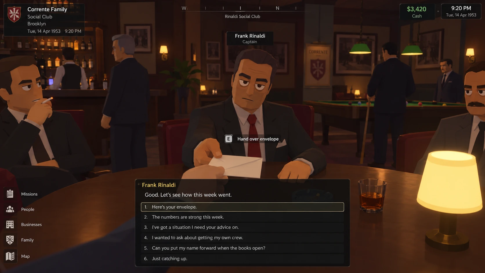
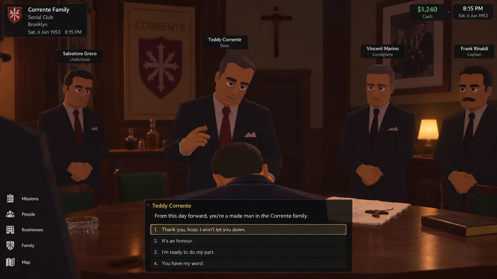

# The 3D direction: visual reference

Concept images the owner shared on 27–28 October 2026 for a possible future of OMERTÀ: a 3D game in a chunky, stylised style
(Schedule One in spirit, warmer and more detailed), where you walk into the places, hand over the envelope yourself, play the jobs
as jobs and stand in the room when you are made.

This is a direction, not a plan of work. The principle that goes with it: **the simulation is the game; 3D is a way of being in it.**
Everything a scene shows must come from the sim (who is in the room, why, what they know, what they think of you), and every choice
in it must be remembered. A 3D scene that could be a cutscene has missed the point.

Two notes on the images themselves: they are dated 1953; the game is set in 1970. And the rooms are tidier and more posed than the
sim's would be, which would fill them with whoever is actually there that night.

## 01. The Sunday envelope

A captain at his table in the social club, the player handing over the week's envelope, with numbered answers below.

| On screen | In the game today |
|---|---|
| Handing over the envelope | Sunday envelopes and kick-ups (`books.ts`, `econ.ts`); the captain reads your real week: short, late, or better than he expected |
| Numbered answers | Every decision is a numbered `choices()` list (`ui/kit.ts`), keys 1–9 |
| "I wanted to ask about getting my own crew" | Captaincy contenders, crew fit and a captain's preferred successor (`succession.ts`); the proactive ask is planned for the associate and soldier increment |
| "Can you put my name forward when the books open?" | The induction line and the books, opened only for a stated reason (`succession.ts`, Story › Your career) |
| The men around the room | Who is at the club and why (`club.ts`, NPC schedules); each one there for his own reason, and he remembers you |
| Missions / People / Businesses / Family / Map | Today, People, Business, Story and the street picker |

## 02. The induction

The boss, flanked by the underboss, the consigliere and the player's captain; a gun on the table; the words that make him.

| On screen | In the game today |
|---|---|
| The ceremony | A playable meeting (`meetings.ts`, `openInduction`), reached through the books opening, the line and the boss's decision (`madeFromLine`) |
| Who stands in the room | The real holders of each seat: underboss by the boss's picture, consigliere by his own appointment (`orgs.seatConsigliere`), the captain who sponsored you |
| What it means afterwards | Status changes (made), position (soldier), what you may do (`standing.ts`), and your crewmen may now go on the family's record |

What the image's answers miss: all four are ways of saying yes. In OMERTÀ the choices in that room should differ and be remembered,
for example thanking the sponsor by name in front of the boss (he remembers, and so do the men who did not back you); how you take the
oath with the gun on the table; and the man who was passed over (the sim records him), at the back of the room, and what you say to
him that night.

## If it is ever built

A first step would be one evening as a vertical slice, on the real simulation: wake in your apartment, drive to the social club, hand
the captain the envelope (he answers what the books say), take a car-to-order job and play it on one street, with a crewman who
behaves as the sim says he would. Open questions before then: real-time versus action-costed time; the engine (Godot, with the sim
ported or bridged, against Three.js in the browser, which keeps everything but limits the look); and how much of the person-first
work the 3D would take time from.

## 03–04. The truck (described; the image files were not saved to disk, so add them here as 03-truck-shootout and 04-truck-driver)

Two scenes of a truck robbery on a country road. In one, the crew (Rocco DeLuca, Salvatore Marino, Frankie Esposito, with health bars)
fire on an armoured truck while its driver stands with his hands up, an objectives box top right (stop the truck, take the money, get
out before the police arrive), a minimap and an SMG's ammunition; Rocco shouts and the player answers from a numbered list. In the
other, a quieter version: the driver on his knees, a crewman's pistol on him, a big man in a fedora standing over him, and the choice of
what happens to him (take the cash and let him go, rough him up for who sent it, make an example of him, call it off).

| On screen | In the game today |
|---|---|
| A truck job with your crew | Truck hijacks are a playable racket (`rackets.ts`, `resolveHijack`; Phase 1 "truck" increment) |
| The crew beside you, named | Your crewmen and their own natures (`crewlife.ts`, `temper.ts`); the man shouting is the man the sim says is the hothead |
| What happens to the driver | The same choice as any beating or killing (`actions.ts`), with witnesses, heat, and a driver who remembers faces |
| "Rough him up until he tells us who sent it" | Knowledge as a mechanic: what he knows is what he witnessed or was told (`core.ts`) |
| Get out before the police arrive | Heat and arrests (`police`, `jail`) |

The second image is the closer fit. OMERTÀ's violence is a decision with consequences, not a shooting gallery: the driver's choice
is the scene; a firefight is a failure of planning, and a dead driver is a murder the precinct works. If jobs are ever played, the
shooting is the rare outcome and the people are the point.
